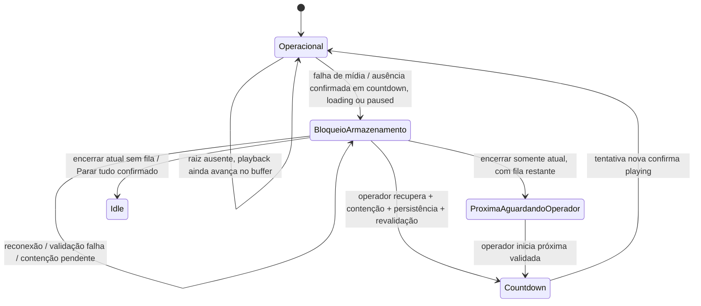

# F0-08 — Resiliência do Standalone Player à indisponibilidade da biblioteca durante uma sessão

Subdivisão autorizada do ticket F0 0006/0000, posterior à infraestrutura T3 e anterior à homologação F0/F1–F4. O proprietário autorizou implementação integral e o modal diretamente no código, sem consulta/alteração Doop. Essa exceção é específica do modal F0-08. P1/P2/P3 permanecem aprovadas. Não há persistência nova da fila entre processos.

## Diagnóstico e contrato

Antes desta subfase, `PlayerPlaybackService.resolveFailedAttempt` já enviava Stop, revogava grant e persistia falha/uncertainty, com contenção limitada e correlação hostEpoch/attemptId/sequenceNumber. `StandalonePlayerSequence.onPlaybackEvent` convertia a falha em blocked/uncertain, preservando pending, mas só Stop All recuperava uma falha conhecida: a resolução explícita limpava toda a sessão. Não havia comando para recuperar a ocorrência preservando as demais nem watchdog de progresso. Sondas preservavam índice/configuração, sem política de suspensão de countdown/paused. Esses mecanismos anteriores continuam válidos e foram estendidos, não removidos.

O Main continua autoritativo. `storageRecovery` é metadado técnico de um snapshot blocked/uncertain, não um novo estado operacional V1, nem outra fila. Contém target (entryId/musicCode), fase (countdown/media/transition), disponibilidade, contenção, intenção de pausa e `positionRestorable:false`. Não exporta caminho, fingerprint físico ou API genérica de filesystem. Renderer só envia comandos restritos validados; Preload valida chaves, tipos, fase, códigos e target.

A reconexão nunca é comando de recuperação. Um EOF válido anterior à falha não é desfeito; celebração termina uma vez, mas um próximo start que falha conserva o head reservado. Erro/timeout não vira EOF. Arquivo removido/inacessível, identidade alterada e falta de progresso têm códigos distintos; indisponibilidade de raiz é observação separada.

## Política por estado

| Estado | Perda de acesso | Retorno / operador |
| --- | --- | --- |
| Idle | Índice/configuração mantidos; modal informativo dispensável com Entendi. Seleção ausente é rejeitada sem sessão fantasma | Detecta retorno e retira aviso; não toca música |
| Playing | Sonda negativa sozinha não interrompe buffer. Erro de mídia ou 15 s sem avanço observado após playing aciona contenção existente | Mantém ocorrência e ordem; reconexão só atualiza modal |
| Paused | Preserva intenção de pausa e ocorrência; Stop/clear correlacionados contêm a mídia, sem chamar resume | Operador escolhe reiniciar do início ou encerrar só atual. Pausar após perda também protege a retomada |
| Countdown | Cancela timer/generation, preserva alvo e milissegundos restantes, mantém pending | Após revalidação e comando explícito, rearma apenas o tempo restante; callback velho é descartado |
| Loading / transição | Reserva é invalidada; Stop cancela geração de playback e revoga recursos. Target não é consumido | Só recupera com contenção confirmada; nova tentativa revalida antes de carregar |
| Celebração | EOF confirmado e celebração permanecem válidos; acesso ausente não produz celebração extra | Ao tentar a próxima, falha conserva head/prioridade. Retorno não avança sozinho |
| Recuperação | Repetição de erro/sonda não recria fila, timer ou tentativa | Reentrância protegida por reservation/operationId. Stop All supera recuperação pendente; resultado tardio não publica |
| Shutdown | Fecha admissão e cancela timers/efeitos pelo mecanismo existente | P1 mantém startup seguro; fila desta sessão não é prometida entre processos |

## Contenção e durabilidade

Idle técnico, stopped sem tentativa e completed confirmado são verificados; failed exige Stop ACK ou host terminado. Uncertain não é liberado por tempo decorrido: contenção confirmada e ausência de erro de persistência são necessárias. Sua resolução usa `recovery.leaveStopped`/`resolveRecoveryAsStopped` existentes, persistindo o término antes de limpar superfície e permitir nova tentativa. Falha de persistência ou clear mantém proteção. A exceção à assert de recovery é restrita aos três comandos de resolução com `storageRecovery.contained`, cuja execução confirma novamente estado/reserva; não altera recovery de startup, Gestão ou comportamento default compartilhado.

Conhecida a falha e confirmada contenção, limpar superfície técnica para idle não libera a sequência: ela continua blocked no Main com música/fila preservadas. Isso permite que a biblioteca reconcilie sem ficar presa atrás de um engine failed, e não autoriza autoplay. `recover-storage` e `discard-interrupted` são comandos idempotentes pelo operationId; comandos concorrentes são serializados no arbiter, I/O fora dele. Stop All conserva sua confirmação e semântica de limpar tudo, e invalida efeitos antigos.

## Identidade e posição

A admissão guarda em memória por ocorrência um hash sobre caminho canônico, dev, inode, tamanho, mtimeNs e birthtimeNs de handle validado. Revalidação manual compara a identidade; `playImmediately` compara novamente o handle preparado com a identidade esperada, protegendo também a janela do countdown. O protocolo mantém revisão/capability e revalidação física existentes. Arquivo substituído, mesmo reindexado sob o mesmo código/caminho, gera MEDIA_CHANGED; não há fallback para outro arquivo. Ambiguidades conhecidas continuam rejeitadas. Não é hash integral de conteúdo nem defesa contra manipulação maliciosa de todos os metadados do filesystem.

O transporte V1 não possui comando seek com confirmação correlacionada. Portanto a F0-08 **não promete restauro de posição**. O modal informa claramente a limitação e oferece reinício do início; não afirma que uma posição foi salva. Na pausa voluntária, informa a intenção anterior e exige escolha explícita. Não adiciona buffer próprio nem pré-carga.

## Progresso e eventos

Watchdog opt-in apenas no Standalone: relógio monotônico e timer cancelável. Após playing, 15 s sem currentTime crescente observado causa MEDIA_STALLED e contenção; timeupdate crescente renova evidência, playing duplicado não renova o prazo, pausa/Stop/dispose cancelam o timer. Waiting/stalled isolados ou waiting inicial não são falha nem EOF. Eventos já passam por correlação hostEpoch/attemptId/sequenceNumber, terminal/failurePending e arbitração da sequência. O watchdog detecta falta de evidência de progresso do host; não é diagnóstico físico definitivo do HD. [Semântica dos eventos de mídia — padrão HTML](https://html.spec.whatwg.org/multipage/media.html).

## Modal autorizado

Modal no mesmo documento, paleta e componentes existentes; responsivo, role dialog/aria-modal, status anunciado e foco inicial. Tab/Shift+Tab permanecem nas ações; Enter/Space ativam botão nativo. Fora dele, atalhos ficam protegidos; Ctrl+Espaço abre a confirmação distinta de Parar tudo. Saída do aplicativo tem prioridade sobre recuperação. Reconexão atualiza informação, nunca aciona botão. Não há nova janela.

Ações: reiniciar do início (ou iniciar a próxima preservada após descarte); encerrar somente a ocorrência atual; Entendi apenas no aviso idle. Sem contenção, ações de mutação ficam desabilitadas. Descartar atual com pending mantém blocked aguardando operador, sem publicar idle operacional com fila oculta. Modal informa a causa, acesso atual, preservação de filas/prioridades e limitação de posição. Configuração/índice continuam mantidos em ausência temporária.

## Testes e evidências

A matriz canônica e o relatório F0 recebem os resultados finais. Unitários usam relógios, gates e falhas determinísticas; protocolo testa EIO depois do primeiro chunk de stream real, sem converter a falha em EOF e exigindo close/EBADF. E2E importa o package Main real através da entrada instrumentada já usada pelo T3, perfil privado e SQLite/IPC/Renderer reais. Gera WebM/VP8 próprio em disco interno, verifica progresso real enquanto a raiz está logicamente ausente e força erro real de recurso Chromium (URL de teste rejeitada pelo protocolo), evitando reutilização de bytes já decodificados. A falha EIO do stream é comprovada separadamente no teste de protocolo, não atribuída indevidamente ao E2E.

Isso não é prova de USB físico, MP4 do proprietário, ausência de engasgo perceptível, cache frio ou app instalado. D: não é consultada nem acessada. T3 físico permanece NOT RUN e sujeito à proteção contra escrita efetiva do [procedimento T3](fase-f0-t3-operacao.md). F0 não homologada; F1–F4 não iniciadas. Sem commit/push/PR/release/dispatch.

### Resultado técnico

Implementação/validação concluídas: 32 novos casos unitários, Sequence 100/100, playback 35/35, protocolo 11/11, Main real Linux/Windows, dez regressões P1 Main Linux e T3 sintético PASS. Runner Windows 360 unitários/10 suítes, quatro E2Es biblioteca + T3S + F0-08, cleanup sem processos residuais. [Ledger do snapshot final](fase-f0-08-evidencias.json), [relatório detalhado](fase-f0-relatorio.md#f0-08--resiliência-a-falhas-de-armazenamento-durante-a-sessão). Code hashes conferíveis; docs posteriores não foram apresentadas como snapshot Windows retestado. T3 físico NOT RUN e F0 não homologada.

## Integração com a campanha física unificada

A infraestrutura do T3 foi estendida para cenários de sessão F0-08, com [procedimento específico para testekaraoke](fase-f0-t3-operacao.md#campanha-unificada-t3--f0-08--testekaraoke) e [evidências sintéticas](fase-f0-usb-campanha-evidencias.json). Essa nova autorização permite um modo **descartável com risco aceito**, distinto do protegido: só cópias no pendrive autorizado, nunca o HD original. Não altera a política de preservação do acervo original nem significa proteção contra escrita. F:/D: não foram consultadas/acessadas nesta implementação e a campanha física não foi executada.

Produção F0-08 permaneceu byte a byte igual aos 11 hashes comparados. Corrigiu-se somente uma corrida de foco do seu harness E2E: agora espera o frame de autofocus, envia Enter ao botão de descarte e confirma o comando no Main. O controle da sequência antiga comprovou Retry indevido; E2E corrigido Linux/Windows PASS sem enfraquecer assertions. Recuperação física, quando autorizada, permanece exclusivamente manual; ausência de falha por buffer ou perda da janela temporal rende PARTIAL/NOT REPRODUCED, sem injeção de erro ou alongamento de estados. F0 não homologada.
