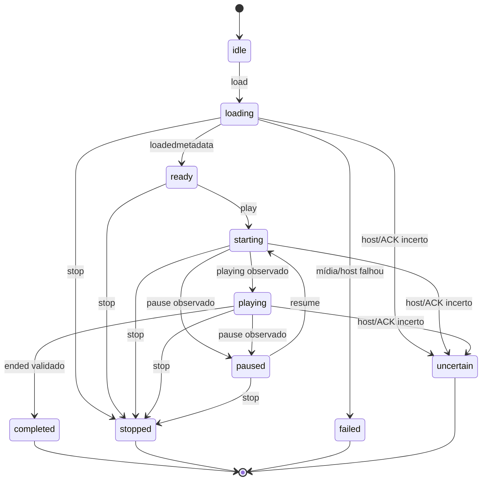

# Reprodução local Chromium

**Status:** engine Chromium, serviços de playback, recuperação local, sequência local e catálogo opcional foram implementados nas Phases 5C–5F-A. Na Phase 5F-B, a interface e a janela independente de vídeo foram integradas para **Player isolado**. O proprietário autorizou tratar os frames Doop em estado draft como aprovados para esta implementação; nenhum canvas foi alterado. Os E2Es Linux e a validação nativa Windows pelo runner oficial passaram. A UI do Controller/Combined, conexão LAN e orquestração autoritativa de apresentações no Combined permanecem fora deste escopo.

## Escopo e propriedade

A Phase 5C entrega a execução Chromium do vídeo local. A Phase 5D acrescenta seleção manual por código e uma sequência local explícita, sem criar fila Controller. A Phase 5F-A habilita avanço automático somente em modo Player isolado, depois de EOF candidato validado e apenas para o próximo item cadastrado. Stop, erro, Restart, substituição, timeout, crash, evento duplicado/antigo e recovery pendente não avançam. Em Combined, a reprodução continua sem orquestração automática de apresentações; Controller mantém autoridade sobre fila, sessões, apresentações e histórico. Playback não grava esse estado operacional nem marca apresentações como concluídas.

O Renderer de mídia (`player-playback.html`) contém somente a área de vídeo, sem controles públicos sobre a imagem. O painel de controle é um Renderer separado (`player-control.html`) e usa bridge independente. A UI do Reprodutor isolado foi ligada à engine; ela não é reutilizada pelo Controller nem pelo Combined nesta fase.

Na Phase 5F-B, Player-only abre o painel `player-control.html` com a superfície Chromium de vídeo integrada à tela aprovada do Reprodutor. A ação explícita “Abrir em outra janela” move essa mesma superfície para uma janela independente; não duplica o elemento de mídia. A janela de saída começa fechada e parada. Abrir o app não inicia ou retoma música. O painel consome snapshots e eventos Main-side pelo Preload restrito. O Renderer não agenda faixas nem é autoridade de reprodução. Essa integração não ativa janela Player em Combined, nem altera a navegação da fila Controller.

## Módulos

| Módulo | Responsabilidade |
|---|---|
| `src/player-playback-contracts.ts` | Tipos de estado, comandos, observações, erros e eventos. |
| `src/player-playback-service.ts` | Estado autoritativo local no Main, resolução de mídia pela biblioteca, serialização, identidades e filtragem de eventos. |
| `src/chromium-playback-host.ts` | Transporte IPC entre Main e um `WebContents` autorizado, readiness, ACKs e término do host. |
| `src/player-media-protocol.ts` | Scheme local `kq-media`, concessões opacas e streaming seguro para Chromium. |
| `src/player-playback-renderer.ts` | Adapter de `HTMLVideoElement`; converte eventos nativos em observações tipadas. |
| `player-preload.ts` | API `contextBridge` restrita ao host de playback. |
| `src/player-playback.html` / `src/player-playback.css` | Documento técnico sem controles de operador. |
| `src/manual-playback-service.ts` | Controles manuais Main-side, sequência local volátil e avanço condicionado ao EOF validado somente no modo Player. |
| `src/player-ui-contracts.ts` | Snapshot e operações IPC tipadas, sem caminho local e sem APIs arbitrárias de filesystem. |
| `main.ts` / `preload.ts` | Composição por modo e ponte restrita para contratos do Player; seleção de CSV ocorre por diálogo Main-side. |
| `src/player-control-renderer.ts` / `src/player-control.html` / `src/player-control.css` | Painel do modo Reprodutor: entrada por código, música atual, sequência local, controles, configurações de acervo/CSV e estados de recuperação/erro. |
| `player-control-preload.ts` | Bridge estreito da interface de controle; encaminha comandos e snapshots sem expor Node, SQLite ou filesystem. |
| `src/player-video-window.ts` | BrowserWindow independente para o host Chromium de produção, com saída em janela e fullscreen sem controles sobre o vídeo. |
| `src/welcome-renderer.ts` / `welcome-preload.ts` | Seleção de modo na primeira abertura quando o perfil não tem configuração nem dados operacionais anteriores. Perfis legados preservam o comportamento Controller. |

O adapter usa diretamente Chromium/Electron. Não há framework de plugins nem processo mpv.

## Inicialização por modo

- **Controller:** não inicializa a biblioteca de mídia, o protocolo nem `PlayerPlaybackService`; preserva banco e comportamento Controller existentes.
- **Player:** inicializa a biblioteca local, registra `kq-media`, cria `PlayerPlaybackService` e `ManualPlaybackService`, abre `player-music-catalog.sqlite` para metadados opcionais e cria o painel de controle com a superfície de vídeo inline. A janela de saída independente é criada sob demanda. Não abre `karaoke.sqlite`, tabelas operacionais ou fila Controller. A sequência continua volátil e é separada da fila Controller.
- **Combined:** inicializa serviços de biblioteca/playback e mantém uma única conexão SQLite Controller. Nesta fase não cria a janela Player nem ativa a sequência local com auto-avanço; a orquestração Combined permanece com Controller/Phase 7. Não usa loopback LAN.

O catálogo Player-only rejeita arquivos não regulares, links/reparse points e identidades que aliasem `karaoke.sqlite` ou seus arquivos WAL/SHM antes de executar PRAGMAs de escrita. A identidade do arquivo é revalidada depois que SQLite abre o banco. Como o processo usa arquivos locais sem um lock de filesystem contra outros processos do mesmo usuário, uma troca maliciosa concorrente do caminho continua sendo uma limitação de TOCTOU do sistema operacional.

Na saída normal em Player-only, `before-quit` consulta o contrato de shutdown do coordenador. Sem playback ativo, a saída continua; com uma tentativa ativa ou cuja contenção não foi confirmada, o painel apresenta a decisão de manter tocando ou interromper e sair. Cancelar preserva a tentativa; confirmar usa a parada controlada e não trata Stop como EOF. A janela independente de vídeo não encerra sessão Controller. Em Controller/Combined, esta UI de confirmação do Player ainda não foi integrada.

## Recuperação persistente — Phase 5E

`PlayerPlaybackRecoveryCoordinator` acompanha as transições serializadas do `PlayerPlaybackService`; não mantém uma segunda máquina de playback. `PlayerPlaybackRecoveryStore` grava `player-playback-recovery.json` no `userData` do processo. O registro versionado (schema 1) contém `revision`, `status`, `attemptId`, `musicCode` canônico de cinco dígitos, `playbackStatus`, `lastTransition`, `updatedAt` e, quando aplicável, `startedAt`, `terminalAt` e `reason`. Não guarda caminho de arquivo, mídia, fila, histórico Controller, credenciais ou cópia do catálogo.

Na Phase 5F-A, registro ilegível/corrompido continua bloqueando playback. A resolução explícita cria um journal verificado e move cada arquivo inválido por rename atômico no mesmo diretório para um nome aleatório de quarentena. O Store verifica tamanho e SHA-256 depois do move antes de gravar e reler um registro `idle` válido; mismatch deixa o journal e mantém o bloqueio. Uma interrupção pode ser retomada na próxima leitura. Um resumo diagnóstico tipado evita expor bytes brutos ou caminhos à UI. O limite de evidências preservadas é 50 arquivos. Como em outras operações locais, um processo externo com permissão para modificar o mesmo `userData` ainda pode disputar o filesystem; o hash pós-move detecta divergência observada, mas não prova resistência a qualquer escritor local privilegiado.

As gravações usam arquivo temporário exclusivo, flush do arquivo, rename e os sidecars `.player-playback-recovery-transaction.json` (`prepared`/`committed`) e `.player-playback-recovery-previous.json`. Na leitura, uma transação interrompida antes da confirmação restaura o snapshot conservador anterior; esquema desconhecido, registro contraditório, truncado ou corrompido é preservado e resulta em `unreadable`, não em “sem recuperação”. Leituras são limitadas a 16 KiB. Tentativas novas são bloqueadas se o estado não puder ser lido ou persistido com segurança.

### Ordem durável e retomada

- A intenção de playback é persistida antes de conceder a mídia ao host Chromium. Assim, encerramento entre intenção e início observável fica pendente, em vez de desaparecer.
- Pause/Resume, Restart, substituição, Stop, EOF e falha são registrados no mesmo caminho serializado. Stop só vira confirmado após ACK do host; timeout, crash e host sem contenção comprovada ficam `uncertain`.
- EOF só publica `natural-end-candidate` depois que a identidade/estado da tentativa forem validados e o terminal `completed` estiver duravelmente gravado. Falha da gravação não publica conclusão.
- Na inicialização, tentativa ativa, pausada ou incerta vira `pending`; o serviço fica parado/idle e não carrega, retoma, reproduz, marca como cantada ou avança faixa automaticamente. Registros terminais confirmados continuam `resolved`.
- Enquanto a tentativa recém-iniciada permanece ativa na mesma instância, seu registro ainda é escrito duravelmente para permitir recuperação após um reinício, mas não é apresentado como uma decisão de recuperação sobre os controles ao vivo. Se a tentativa fica incerta durante a sessão ou é encontrada no startup seguinte, a recuperação volta a ser apresentada.
- Replay explícito resolve o código canônico novamente pela biblioteca atual e cria nova tentativa. Escolher outra faixa usa o `ManualPlaybackService`. “Deixar parado” resolve a pendência como `dismissed`, sem EOF. Ações exigem o attempt pendente atual; repetição concorrente do dismiss não cria uma segunda revisão terminal.
- O processo/Renderer que falha invalida a tentativa e seus eventos tardios. Contenção Stop/terminação do host é limitada; se a destruição não puder ser comprovada, o resultado permanece incerto. A falha Player não encerra Controller nem seu banco.

O encerramento do app durante reprodução exige uma decisão explícita pelo contrato `requestShutdown`/`confirmShutdown`/`cancelShutdown`. Confirmar interrompe pelo caminho seguro e persiste Stop confirmado ou incerteza; confirmar o fechamento não é EOF. Na Phase 5F-B, a UI aprovada para Player-only apresenta essa decisão no painel de controle. A janela de vídeo permanece separada. A UI equivalente para Combined continua pendente; a persistência de recuperação funciona sem callbacks de shutdown.

### Durabilidade e limites

POSIX também sincroniza o diretório após rename. Node/Electron não oferece aqui sincronização de diretório equivalente no Windows; o journal protege falhas de processo observáveis e as transações interrompidas, mas não prova sobrevivência a corte físico de energia, cache do dispositivo ou falha do sistema de arquivos. Não houve teste de perda física de energia. Crash de processo/forçado é a evidência disponível, não uma prova de todas as causas de término.

## Identidade, comandos e ordenação

`ManualPlaybackService.playByMusicCode()` aceita código textual com 1–5 dígitos ASCII, sem zero inicial, e usa `normalizeCatalogCodeForVideoMatch()` para canonicalizar a cinco dígitos (`1001` → `01001`; `23242` permanece `23242`). O Main resolve e revalida o código na `VideoLibraryService`; não recebe caminho arbitrário. CSV, Controller e LAN não são necessários para selecionar vídeo local. Registro CSV ausente não bloqueia playback; código inválido, vídeo ausente/inacessível, biblioteca indisponível ou duplicata ambígua retornam resultado explícito sem fallback.

Uma tentativa ativa possui `attemptId`, época do host e revisão do inventário. Comandos incluem `commandId` e `attemptId`; observações incluem `attemptId` e sequência monotônica por elemento de mídia. O Main ignora observações com época/tentativa errada, sequência repetida/antiga ou tentativa terminal. Só um host pode ser anexado ao serviço.

As transições curtas são serializadas no Main. Espera por readiness/ACK ocorre fora da fila de transição para que Stop/Dispose não fiquem presos atrás de um Promise do Renderer. `Stop` ou uma operação mais nova invalida reservas que ainda aguardavam readiness. Não há retry automático de comandos.

| Operação | Comportamento atual |
|---|---|
| `load(code)` | Resolve e valida mídia, substitui tentativa anterior e envia URL opaca ao host. Não inicia playback; o estado só passa a `ready` após `loadedmetadata`. |
| `play()` | Válido em `ready`; estado `starting` é distinto do início observado. O evento `playing` muda para `playing`. |
| `pause()` | Válido durante início/reprodução; ACK confirma aceitação, e a observação `pause` atualiza o estado para `paused`. Timeout/host encerrado invalida a tentativa, registra incerteza e envia Stop best-effort. |
| `resume()` | Reusa a mesma tentativa e pede `play()` a partir de `paused`. |
| `restart()` | Cria nova tentativa para o mesmo código, recarrega e inicia desde o começo; eventos da tentativa anterior não afetam a nova. |
| `stop()` | Invalida a tentativa, revoga a concessão e interrompe mídia; nunca significa EOF. |
| `dispose()` | Fecha o serviço, invalida tentativa, envia Stop quando possível, remove listeners/handlers e rejeita novos comandos. |

`ManualPlaybackService` mantém uma sequência local volátil com IDs de item, música atual, itens pendentes e histórico de navegação necessário para Previous. `addToSequence()` normaliza e revalida o código pela biblioteca; `removeFromSequence()`, `reorderSequence()` (permutação exata dos IDs pendentes) e `clearSequence()` não persistem dados. Next/Previous só usam itens explicitamente conhecidos; sem contexto retornam `unavailable / NO_SEQUENCE`, e nas bordas retornam `boundary / SEQUENCE_BOUNDARY`. Não há wrap-around nem incremento/decremento numérico.

O Main habilita `autoAdvanceOnNaturalEnd` somente para o modo Player isolado. Ao receber `natural-end-candidate`, o serviço exige correspondência com a tentativa ativa e com o estado `completed` validado pelo `PlayerPlaybackService`; deduplica por attempt ID e dispara apenas o item pendente na cabeça da sequência. O item só é removido após novo playback aceito/iniciado. Falha mantém o item pendente e não pula adiante. Stop, Restart e substituição invalidam a autoridade antiga antes de comandos posteriores; EOF antigo/duplicado não pode avançar. Em Combined o avanço automático local está desligado nesta fase para não substituir a orquestração Controller, que será definida na Phase 7. A sequência não é persistida e não é a fila autoritativa.

`ManualPlaybackService` devolve resultados tipados para adição, remoção, reordenação, limpeza e navegação. O snapshot expõe `current`, `pending` e `previous`, sem dados de Controller. Seleção manual pode iniciar imediatamente ou consumir um item equivalente pendente sem adivinhar outros códigos.

O serviço traduz resultados em `started`, `accepted`, `unavailable`, `boundary`, `uncertain` ou `failed`. `started` só é devolvido quando a operação de playback foi observada como iniciada. Pause/Resume podem retornar `accepted` após ACK do comando, antes da observação posterior de estado. Stop confirmado pela engine é `stop-acknowledged`; ACK não é EOF. Falhas e incerteza nunca iniciam outra música.

Stop repetido é coalescido pelo serviço de playback. Quando comando/ACK expira, resultado continua incerto: o serviço invalida a autoridade da tentativa antiga, tenta uma única contenção limitada com Stop e, se necessário, terminação do host Player controlado. A terminação só é confirmada quando o callback do dono informa sucesso e o WebContents está destruído. Se não houver confirmação, estado permanece incerto e não se afirma que a mídia parou. `dispose()` aguarda Stop já admitido e preserva resultado/identidade da contenção. Não há retry sem limite, encerramento do app inteiro nem encerramento da janela Controller. Recuperação persistente não faz parte da Phase 5D.

## Estado e eventos

Estados públicos: `idle`, `loading`, `starting`, `ready`, `playing`, `paused`, `stopped`, `completed`, `failed`, `uncertain` e `disposed`.

O Renderer observa `loadedmetadata`, `playing`, `pause`, `ended`, `error`, `emptied`, `waiting` e `stalled`. Main reduz essas observações a estado/eventos relevantes; `waiting`/`stalled` não são conclusão nem mudança terminal. O ACK confirma que o comando foi aceito sincronicamente pelo host, não que metadata chegou ou playback começou.

### Fim natural e interrupção

`ended` gera `natural-end-candidate` somente se pertence à tentativa ainda ativa, o Main já observou `playing`, o estado atual é `playing` e duração/posição são números finitos, com duração positiva e posição ao menos igual à duração. Evidência ausente/incoerente resulta em `uncertain`. Tentativa terminal só emite um resultado; EOF duplicado e eventos antigos são descartados.

Stop, Restart, substituição, falha de mídia, término do Renderer e timeout nunca viram natural EOF. Crash/ACK incerto remove a tentativa ativa, emite interrupção/incerteza e não reinicia playback.

`natural-end-candidate` é uma observação do playback local, não uma conclusão de música cantada ou apresentação. O Renderer fornece a observação `ended` e valores de tempo; Main valida correlação/coerência, mas não verifica independentemente cada frame ou amostra de áudio. A Phase 7 deve definir a confiança e validação Controller antes de afetar histórico.

## Acesso local à mídia e segurança

Main resolve pelo código e revisão da biblioteca. A URL `kq-media://playback/<token>` contém token aleatório de 256 bits, não caminho; o token só identifica uma música/revisão corrente e é revogado ao encerrar/substituir a tentativa. O handler aceita GET/HEAD, Range de bytes, `nosniff` e `no-store`; MIME é selecionado pela extensão, sem afirmar suporte a codec.

`ChromiumPlaybackHost` aceita IPC somente do `WebContents` e frame principal esperado, bloqueia navegação para fora do documento permitido e nega novas janelas. O Preload não expõe filesystem, SQLite, shell ou Node. O documento usa CSP com default deny, `media-src kq-media:` e sem rede. O harness verifica `contextIsolation: true`, `nodeIntegration: false`, `sandbox: true` e `webSecurity: true`; a BrowserWindow final de produção ainda precisa ser criada com as mesmas proteções.

A biblioteca revalida raiz/identidade e abre o arquivo por handle em cada requisição de mídia. Isso reduz traversal e troca do path entre indexação e abertura, mas não impede outro processo local de alterar bytes enquanto Chromium os lê (limite TOCTOU). Origin ausente é aceito por compatibilidade de mídia Chromium; a segurança principal vem da concessão opaca, curta e revogável.

## Testes executados

- `npm run compile` — PASS.
- `npm run test:unit` — PASS após a Phase 5E; inclui 24 testes focados de recuperação e 20 testes do runner Windows, além das suites existentes.
- `npm run test:e2e:player-playback:headless` — PASS em Electron real no Linux, exercitando `ManualPlaybackService` e serviço Chromium de produção: `1001`→`01001` sem CSV, controles Pause/Resume/Restart/Stop, navegação explícita, rejeição de mídia ausente/duplicada, substituição sem EOF, EOF natural da amostra 01001 após 199 s e crash do Renderer classificado como incerto sem autoplay.
- E2E Electron de operating modes, IPC validation e Round Robin — PASS. O histórico flake A2/C1 não reapareceu nesta validação.
- `npm run test:e2e:multi-instance:windows -- --approve-untracked --player-playback` — PASS via runner oficial em Windows, Node.js 24.11.0/npm 11.6.1 e Electron 45.0.0 / Chromium 156.0.8078.48. Fingerprint final: `826d43212a7c016faa61de8350df52fc3361f62a4f2d02923f8ad5e2c9bf3f46`. O teste real atingiu EOF de 01001 após 199 s; não deixou processos ou perfis temporários residuais.
- `git diff --check` — PASS.

### Recuperação Phase 5E

- `node build/tests/player-playback-recovery.test.js` — PASS, 24/24; inclui falha pós-rename/fsync, schema inválido, EOF duplicado/obsoleto, containment e decisões de recuperação concorrentes.
- `npm run test:e2e:player-recovery:headless` — PASS em Linux com processos Electron reais: encerramento abrupto e restart no mesmo perfil isolado, pending sem autoplay, replay com novo attempt, Stop confirmado, EOF natural real seguido de restart e preservação do SQLite Controller em Combined após crash do Renderer.
- `npm run test:e2e:multi-instance:windows -- --approve-untracked --player-recovery` — PASS pelo runner oficial. Node nativo 24.11.0; branch `feature/remote-player-lan-integration`; HEAD `b7516bdaf092a03d841ea8efe3b41785eccdfeb1`; fingerprint `736c13329ccdd5152f2cdea93beb31720478258db42823ecfaaf848d96d1077e`. A E2E exercitou os mesmos cenários, incluindo EOF natural real e crash de Renderer em Combined; perfil/processos residuais e limpeza: PASS. O modo reporta `WINDOW_FOCUS NOT APPLICABLE`; esse teste não valida gerenciamento de foco/minimize/restore.
- A primeira tentativa nativa terminou FAIL porque o runner aplicou indevidamente o gate de foco de outra suíte, apesar da E2E de recuperação não exigir foco. O runner foi corrigido e coberto por teste unitário; a nova execução completa passou.
- `git diff --check` — PASS após as alterações da Phase 5E.

Os testes automáticos não avaliam áudio audível ou sincronização percebida; essa evidência humana foi registrada na decisão de engine e no [spike histórico](mpv-technical-spike.md). O teste com Chromium headless não é prova de saída audiovisual física.

### Phase 5F-B — integração visual Player-only

**Implementado:** o Main abre o shell de controle e uma janela Chromium independente apenas no modo Reprodutor. A interface pode configurar/atualizar a biblioteca por diálogo nativo do Main, importar/substituir CSV opcional e operar reprodução por código. Música atual, metadados, status, progresso e sequência são renderizados a partir dos snapshots/eventos do Main. A sequência suporta add/remove/reorder/clear e permanece volátil. O botão “Tocar agora” preserva os demais itens pendentes segundo o contrato do `ManualPlaybackService`; o auto-avanço depois de EOF natural válido continua sendo responsabilidade desse serviço, não de timers React/Renderer.

A superfície de vídeo aparece inline na tela do Player por padrão. “Abrir em outra janela” destaca a mesma superfície em uma janela independente; playback não é duplicado nem reiniciado. F11 alterna fullscreen e Esc sai dele sem reiniciar playback; a proporção é mantida com `object-fit: contain`. Os comandos Play/Pause/Resume/Restart/Next/Previous atuam na localização de vídeo escolhida e não devem movê-la implicitamente entre inline e janela externa. O painel implementa os diálogos de recuperação válida, recuperação inválida, falha de mídia e encerramento durante reprodução, consumindo apenas os resultados autorizados pelo backend. A seleção de pasta usa `dialog.showOpenDialog` no Main; o Renderer não recebe caminho privilegiado. O Preload do Player não expõe bridge Controller nem `require`/`process` Node.

**Validação Linux executada:**

- `npm run compile` — PASS.
- `npm run test:unit` — PASS, incluindo a regressão que distingue tentativa ativa da sessão atual de recuperação deixada por processo anterior.
- `npm run test:e2e:player-control:headless` — PASS em Electron real: Preload/IPC, seleção e indexação, catálogo CSV isolado, normalização `1001`→`01001`, controles, sequência, renderização Chromium de vídeo real e ausência de SQLite operacional Controller.
- `npm run test:e2e:player-playback:headless` — PASS; o EOF real de 01001 foi observado após 199 s, a faixa explicitamente enfileirada avançou, e crash do Renderer foi classificado como incerto sem autoplay.
- `npm run test:e2e:player-recovery:headless` — PASS; término abrupto/restart sem autoplay, replay explícito, Stop confirmado, EOF real após restart e preservação do banco Combined.
- `npm run test:e2e:operating-modes:headless`, `npm run test:e2e:video-library:headless` e `npm run test:e2e:music-catalog:headless` — PASS; Player abre as janelas aprovadas sem criar SQLite operacional, e Controller/Combined preservam suas fronteiras.
- `npm run test:e2e:round-robin:headless` — PASS; o resultado flake histórico A2/C1 não reapareceu.
- `npm run test:e2e:linux` — PASS; suíte completa de regressões Electron Linux, incluindo drag, fila, cadência, persistência, sessões, licença, menus, sugestões, sidebar e diagnósticos.

**Windows nativo — PASS:** `npm run test:e2e:multi-instance:windows -- --approve-untracked --player-control` passou no runner oficial usando Node 24.11.0, npm 11.6.1 e Electron 45/Chromium 156. Branch `feature/remote-player-lan-integration`, HEAD `b7516bdaf092a03d841ea8efe3b41785eccdfeb1`; fingerprint do snapshot validado: `484fd827f75656fa109bd684e5aa4820bfe488d13a5a28f0b89b9689b030699b`. O teste verificou Welcome em perfil novo, seleção de Player, reinício isolado, fluxos reais da interface, mídia local e limpeza do perfil/processos. O runner padrão `npm run test:e2e:multi-instance:windows -- --approve-untracked` também passou com o mesmo HEAD/fingerprint: unitários de migração, modo, biblioteca e catálogo, além de E2Es nativos de multi-instância/foco, modos, biblioteca e catálogo. As cópias temporárias Windows de 01001/01002 foram verificadas por SHA-256 contra os originais, que permaneceram intactos.

**Limites da fase:** os testes headless não confirmam saída audível, sincronização percebida, operação física de segundo monitor nem comportamento de instalador final. A validação humana de áudio/sync aprovada nas fases de engine não foi repetida; a janela e o adapter Chromium mantêm o caminho validado. Player Connected/LAN, fluxo de Controlador conectado, janela/controles Combined e integração autoritativa da fila continuam fora da Phase 5F-B. A execução do runner reportou 15 advisories moderados de dependências no `npm ci`; nenhuma atualização automática foi aplicada.

## Limitações e próximas fases

- **Phase 5D implementada:** serviço técnico de seleção por código e sequência explícita; API interna, sem interface de operador.
- **Phase 5E implementada:** persistência mínima de recuperação, decisões técnicas de shutdown e operações explícitas sem autoplay. Os diálogos aprovados para Player-only foram integrados na Phase 5F-B; Combined continua sem essa UI.
- **Phase 5F-B implementada para Player-only:** shell de controle, configurações locais, recuperação e host Chromium independente vinculados a designs Doop aprovados. A integração visual/operacional de Combined e Player Connected continua pendente e não é afirmada como pronta.
- **Phase 6:** LAN HTTP/WebSocket e adaptação do mesmo contrato de playback.
- **Phase 7:** reconciliação Controller, persistência por música e conclusão autoritativa de apresentação.

### Fase 5F-A — sequência, catálogo Player e recovery inválida

- **Implementado:** sequência local com add/remove/reorder/clear em memória; inclusões concorrentes preservam a ordem de chamada e EOF natural validado avança somente no modo Player isolado. Next/Previous ficam indisponíveis durante a transição de auto-avanço. Combined não autoavança; a orquestração de apresentações permanece com Controller/Phase 7.
- **Implementado:** catálogo CSV opcional Player-only em `player-music-catalog.sqlite`; não abre nem cria SQLite operacional. O parser e o repositório compartilham as regras existentes. Na Phase 5F-A ainda não havia tela; importação/substituição foi integrada na Phase 5F-B.
- **Implementado:** recovery inválida permanece bloqueante. Resolução explícita journaled move os arquivos para quarentena por rename atômico, confirma tamanho/hash depois do move e só libera playback depois da gravação e releitura de `idle`; divergência permanece bloqueada.
- **Implementado na Phase 5F-A:** contratos `KaraokePlayerBridge` no Preload e handlers Main-side para estado, sequência, metadados, importação e recovery. Naquele estágio ainda não havia janela Player no startup nem UI de operador; a integração Player-only foi entregue depois na Phase 5F-B.
- **Testado em Linux:** `npm run test:unit` PASS; E2E de playback real PASS (EOF 01001 após 199 s, avanço a 01002, crash do Renderer incerto); E2E de modos PASS; E2E de catálogo PASS; E2E de recovery real PASS (abrupt termination/restart, sem autoplay, replay explícito, Stop, EOF e Combined preservation).
- **Windows nativo — PASS:** suíte geral do runner central e E2Es focados `--player-playback` e `--player-recovery`. Cada execução sincronizou e verificou o snapshot no checkout NTFS, incluindo branch e HEAD. A suíte geral cobriu migrações, modos, biblioteca, catálogo, multi-instância e janelas; os E2Es focados cobriram playback real/EOF, sequência explícita e recovery com encerramento abrupto/restart sem autoplay. O modo recovery executa também os testes unitários do Store no Windows.
- O Windows Player catalog unit rejeitou hard link para `karaoke.sqlite` antes de inicializar o banco de metadados. O teste nativo de playback observou EOF de `01001` (199 s), início do próximo item explícito e crash de Renderer como incerto. O E2E de recovery verificou replay explícito, Stop, EOF e restart.
- Os vídeos usados para Windows foram cópias temporárias somente leitura verificadas por SHA-256; os originais permaneceram intactos. A execução de `npm ci` nativo reportou 15 advisories moderados existentes; nenhuma atualização automática foi aplicada.

O caminho de contenção depende de um host cujo dono possa confirmar a destruição; no modo Player-only a superfície inline é criada com a tela de controle, enquanto a janela externa de saída é criada sob demanda. Combined ainda não possui essa integração visual. Ainda não há limite de tamanho de sequência; estabelecer limite antes de expô-la a entrada não confiável. A instalação distribuída, codecs fora das amostras MP4 H.264/AAC e operação física em múltiplos monitores ainda não foram verificados. Durabilidade contra corte físico de energia não foi testada e depende de garantias de filesystem/dispositivo que não podem ser provadas apenas pelo processo.

### Phase 5F-B.1 — fidelidade visual, startup e diagnóstico de áudio

**Startup da janela de vídeo:** a inicialização Player-only não deve apresentar a janela de saída. A causa do comportamento anterior foi a chamada de `show(false)` durante o bootstrap: `showInactive()` ainda tornava a janela visível. O bootstrap agora instancia o serviço e o dono da janela sem apresentá-la. A janela aparece somente quando uma ação de reprodução ou “Mostrar janela” a solicita. A E2E valida, em perfil limpo, uma única janela visível, snapshot `idle` e `videoWindow.open === false`.

**Fidelidade e ícones:** o HTML/CSS de controle foi ajustado para corresponder aos estados de biblioteca não configurada, controle manual vazio/em reprodução/pausado e configurações de acervo/catálogo. A seção de configurações usa a hierarquia e os controles do Doop. Os ícones dessas telas são SVGs locais editáveis no código, sem fontes externas ou caracteres substitutos. A E2E verifica que os SVGs visíveis contêm formas renderizáveis e que o logotipo está carregado e dentro do viewport. Os renders Linux e Windows foram inspecionados em 1280×800 CSS para o painel.

O proprietário esclareceu que **“Reprodutor — Player em janela normal”** é a tela do Player com duas opções: reproduzir diretamente na área de vídeo dessa tela ou abrir uma janela de vídeo independente. O playback permanece em uma única superfície Chromium; ao abrir a janela independente, o mesmo `WebContentsView` é movido para ela, sem duplicar a engine ou reiniciar a tentativa. Os controles de reprodução preservam o destino atual. O teste de regressão usa a bridge real Preload/Main para confirmar que Pause, Resume, Restart, Next e Previous não destacam o vídeo automaticamente, tanto inline quanto depois de destacado. O frame foi somente consultado e nenhum design Doop foi alterado. O botão de pareamento que aparece em outros designs continua fora do escopo Player local e não é apresentado como funcional.

`PlayerVideoWindow` cria a superfície sob demanda e serializa sua criação com uma promessa compartilhada (`single-flight`), inclusive quando a primeira abertura recebe solicitações concorrentes. A janela de saída não aparece no bootstrap; “Mostrar janela”, playback ou a ação “Abrir em outra janela” são explícitos. Fechar uma janela de saída ociosa libera o host; fechar durante reprodução continua sujeito à confirmação. F11/Esc atuam na janela que contém a mesma superfície. A janela inline e o vídeo externo preservam a proporção com `object-fit: contain`, inclusive no conteúdo 4:3.

**Áudio:** a E2E real foi executada no Linux/WSLg e no Windows nativo. No Windows, o processo foi `win32` (`electron.exe` do checkout NTFS), Electron 45.0.0, Chromium 156.0.8078.48 e Node.js 24.22.0. Na validação nativa final, a amostra tinha `readyState: 4`, vídeo 1024×768, `muted: false`, `defaultMuted: false`, volume 1, `paused: false`, sem erro de mídia e 84.182 bytes de áudio decodificados. A API `audioTracks` não estava disponível. A repetição Linux observou 86.293 bytes decodificados. Isso comprova decodificação, não saída audível no dispositivo físico. O app não define `muted`, volume zero, `setSinkId` ou flags de Chromium para suprimir áudio; a saída usa o endpoint padrão do sistema. O dispositivo efetivamente selecionado e a audibilidade não foram verificados por loopback. A causa do relato de silêncio permanece **não determinada** e a audição humana no Windows está **MANUAL REQUIRED**.

**Evidência de captura:** foram inspecionadas capturas reais do Electron para biblioteca não configurada, controle manual vazio/pausado, configurações, Player inline composto com vídeo, janela de saída e fullscreen. O ambiente Linux/Xvfb não compôs a `WebContentsView` filha na captura da janela; o harness separa essa captura técnica do screenshot de composição. No Windows, `desktopCapturer` encontrou a janela “Karaoke Queue · Reprodutor” e a captura composta mostrou o vídeo dentro do layout inline com cabeçalho, ações e rodapé. Os ícones SVG visíveis renderizaram sem elementos vazios. O vídeo 4:3 aparece contido, com barras laterais, sem distorção; fullscreen não contém controles sobre as letras. As capturas do teste Windows foram guardadas fora do repositório como evidência temporária; nenhum screenshot foi adicionado ao canvas ou ao Git.

**Revalidação desta rodada:**

- `npm run test:unit` — PASS; todas as suites declaradas pelo script, inclusive bundle do Renderer e testes do runner, concluíram com exit code 0.
- `npm run test:e2e:operating-modes:headless` — PASS após repetir fora do sandbox; a primeira tentativa no sandbox não iniciou o processo Electron. Player-only confirmou não abrir janela de saída no startup; Controller e Combined mantiveram seus lifecycles.
- `npm run test:e2e:player-control:headless` — PASS no Electron Linux real; fluxo Main/Preload/IPC, biblioteca, CSV, sequência, controles, vídeo real e isolamento de SQLite. Diagnostics estão registrados acima.
- `npm run test:e2e:multi-instance:windows -- --approve-untracked --player-control` — PASS pelo runner oficial, com build e Electron nativos na branch `feature/remote-player-lan-integration` e HEAD `b7516bdaf092a03d841ea8efe3b41785eccdfeb1`. O teste confirmou startup sem janela extra, fluxo de biblioteca/CSV, playback, controles, fullscreen, crash/recriação do host e ausência de processo residual; o perfil temporário foi removido.
- Revalidação final após a correção single-flight: `npm run test:e2e:player-control:headless` — PASS em Electron 45 real no Linux; o E2E iniciou duas aberturas simultâneas em perfil limpo antes de existir host e confirmou uma única `WebContentsView`, uma janela de saída e liberação do host ocioso. `npm run test:unit` — PASS, exit code 0.
- Runner final Windows repetido para preservar screenshots fora do perfil efêmero: `npm run test:e2e:multi-instance:windows -- --approve-untracked --player-control` — PASS, Electron nativo `win32`, Node.js 24.11.0/npm 11.6.1 no worker, build nativo, captura composta confirmada, limpeza do perfil/processos. Fingerprint final desta revisão: `9fe48fd07a1b737fe1251ae544ca0e0114176d3299af86165df695411ea70ad0`.
- Cópias temporárias das amostras `01001.mp4` e `01002.mp4` no NTFS tiveram SHA-256 idêntico aos originais. A coleção original foi usada somente para leitura.
- `git diff --check` — PASS.

O status técnico visual/lifecycle desta correção está validado em Linux e Windows nativo, incluindo a interpretação do frame esclarecida pelo proprietário. A validação de **áudio audível** permanece **MANUAL REQUIRED**: nenhuma pessoa confirmou audibilidade nesta rodada, e bytes decodificados não substituem essa observação. Nenhuma configuração global de áudio, dispositivo, volume ou monitor foi alterada; nenhum pacote foi instalado. O `npm ci` nativo reportou 15 advisories moderados; nenhuma atualização automática foi aplicada.

**Revalidação final após retomada:**

- `npm run test:unit` — PASS, exit code 0; incluiu o teste de lifecycle que impede uma criação de host pendente de ressuscitar uma superfície após `dispose`.
- `npm run test:release-workflow` — PASS, 2/2.
- `npm run test:e2e:linux` — PASS; todas as 12 suítes Electron existentes, incluindo fila, Round Robin, cadência, persistência, sessões, licenciamento, menus, sugestões, sidebar e diagnósticos. A ocorrência histórica A2/C1 não reapareceu.
- Após a correção final de IPC que mantém a localização de vídeo escolhida: `npm run test:e2e:player-control:headless` — PASS no Electron Linux real; testou Pause/Resume/Restart/Next/Previous via Preload/Main tanto inline como destacado e confirmou que os comandos não movem a superfície. `npm run test:e2e:player-playback:headless` — PASS; EOF real de 01001 aos 199 s e crash do Renderer incerto. `npm run test:e2e:player-recovery:headless` — PASS; término abrupto/restart sem autoplay, replay explícito com nova tentativa, Stop confirmado, EOF natural/restart e preservação do banco Combined.
- E2Es focados Linux — PASS: modos, biblioteca, catálogo, Player control e recovery. Os testes de biblioteca e catálogo agora confirmam o contrato de startup aprovado: só a janela de controle aparece; playback fica `idle` e a janela de vídeo permanece fechada após startup/restart.
- `npm run test:e2e:player-control:headless` — PASS com Electron 45.0.0 / Chromium 156.0.8078.48 e mídia real; snapshot: vídeo 1024×768, `readyState: 4`, `paused: false`, `muted: false`, volume 1, sem erro de mídia e bytes de áudio decodificados. A captura composta de `WebContentsView` não está disponível em Xvfb; isso não foi tratado como prova de saída audível.
- `npm run test:e2e:player-recovery:headless` — PASS em Electron real; incluiu EOF natural real, persistência de conclusão após restart e ausência de autoplay.
- `npm run test:e2e:player-playback:headless` — PASS na repetição final: Electron real observou EOF natural da amostra `01001` após 199 s e classificou o crash real do Renderer como incerto, sem autoplay.
- Revalidação após o ajuste Main-side da localização do vídeo: runner Windows `--player-control` e runner padrão `--approve-untracked` — PASS. Ambos verificaram branch `feature/remote-player-lan-integration`, HEAD `b7516bdaf092a03d841ea8efe3b41785eccdfeb1` e fingerprint de snapshot `75ce2d55881bdf7f6c186d96c76f5c2b5ea96d299180b42baf9a4628071d0830`; Node nativo 24.11.0, Electron 45.0.0 / Chromium 156.0.8078.48. O teste focado confirmou que os comandos de playback preservam o destino inline ou externo selecionado. O teste padrão passou migrações, modos, biblioteca, catálogo e suites Electron nativas. Captura, perfil e processos temporários foram limpos/verificados.
- As capturas finais Windows foram revisadas visualmente: a tela inline mantém vídeo e rodapé visíveis, o toast não cobre o rodapé, a janela separada e fullscreen mostram somente o vídeo e preservam a proporção. Ícones e diálogos cobertos renderizam. As capturas temporárias não foram adicionadas ao repositório.
- A revisão QA independente não encontrou defeito visual novo, mas confirmou uma diferença pendente: o frame Doop de recuperação pendente também contém **“Pular para próxima música”**. Essa ação não faz parte do contrato implementado nesta etapa e a sequência local é volátil, portanto não foi simulada nem adicionada sem definir primeiro a semântica segura para recuperação.
- A revisão de código final não encontrou blockers. Observação não bloqueante: um toast de biblioteca anterior pode permanecer no painel de controle se “Tocar agora” for usado enquanto o vídeo já está destacado em outra janela; ele não cobre o vídeo nem o output público.
- A revisão de segurança não encontrou blocker para o fluxo local. Antes de release, recomenda-se hardening P3: validar explicitamente frame principal no IPC de fullscreen, bloquear navegação/pop-ups inesperados nas janelas de controle/Welcome e declarar `sandbox: true` explicitamente também na janela genérica.
- `npm run test:release-workflow` — PASS, 2/2; `git diff --check` — PASS após a revisão documental.

**Validação humana atualizada:** o proprietário confirmou que vídeo e áudio audível funcionam ao executar o aplicativo nativamente no Windows. A captura automatizada de bytes continua sendo apenas evidência de decodificação; não substitui essa observação humana. A sincronização A/V percebida não foi reavaliada nesta etapa. A revisão QA também identificou que o frame Doop de recuperação pendente contém a ação “Pular para próxima música”, ausente do contrato implementado; como a sequência é volátil e a semântica de pular após reinício não está definida, essa divergência não foi simulada. Precisa de decisão de produto/contrato antes de ser adicionada.

## Navegação e janela do Player — Phase 5F-B2

Esta seção registra o comportamento atual após a correção B2 e substitui, para a navegação e o fechamento da saída, as descrições anteriores desta página.

- O topo oferece destinos separados **Reprodutor** e **Controle**. Reprodutor abre o estágio de vídeo integrado; Controle abre o painel manual e a sequência local.
- O ícone de monitor do cabeçalho fica desabilitado com a indicação “Pareamento — Em breve”. Ele não abre, mostra ou destaca a reprodução.
- No startup Player-only, a janela principal inicia na área Reprodutor com a superfície Chromium embutida, sem iniciar música e sem criar uma BrowserWindow destacada. Ao navegar para Controle ou Configurações, a superfície inline fica oculta sem parar a mídia ou destacá-la; ao voltar para Reprodutor, a mesma superfície reaparece com a posição atual.
- Somente a ação explícita **Abrir em outra janela** cria a janela destacada e move para ela o mesmo `WebContentsView`. Navegar para Reprodutor enquanto ela está destacada reanexa essa superfície à janela principal.
- Fechar a janela destacada pelo X reanexa o `WebContentsView` à área Reprodutor e fecha apenas a saída. Não solicita encerramento do app, não para, recarrega ou conclui a tentativa. Isso vale com mídia ativa e parada.
- F11 alterna fullscreen; Esc sai. A troca não recria a tentativa nem pausa a mídia. Ao sair, os eventos da janela atualizam os bounds inline e restauram cabeçalho, navegação e rodapé.
- As transições assíncronas entre inline e janela usam uma revisão de destino: somente a solicitação mais recente pode concluir o movimento depois de aguardar a prontidão da superfície.

### Evidência final da Phase 5F-B2

- O snapshot Main agora inclui `returnToInlineRevision`, incrementado somente quando o X da janela destacada reanexa a superfície. O Renderer usa o contador para voltar a Reprodutor mesmo se a notificação intermediária `location: window` não chegar. O primeiro snapshot após carregar a interface estabelece o baseline, sem tratar revisões antigas como um fechamento novo.
- As operações Renderer de mostrar/ocultar a superfície embutida são serializadas. A ação de destacar só abre Controle quando Main confirma que a localização continua sendo `window`; um fechamento ocorrido antes da confirmação permanece na área Reprodutor.
- `npm run compile` — PASS; `npm run test:unit` — PASS, incluindo cobertura do sinal monotônico e do baseline inicial.
- `npm run test:e2e:player-control:headless` — PASS no Electron Linux real com mídia MP4 somente leitura. Além do fluxo existente, o teste suprime e confirma o descarte de uma notificação `window`, fecha a saída imediatamente, verifica o retorno para Reprodutor, fecha a saída ativa durante fullscreen e confirma que o vídeo avança enquanto a área Controle está aberta.
- `npm run test:e2e:operating-modes:headless` — PASS após atualizar uma expectativa anterior da Fase 5C: Player-only agora inicializa a superfície inline pronta, mas continua sem BrowserWindow de saída, sem autoplay e sem SQLite operacional; Controller e Combined passaram seus cenários.
- `npm run test:e2e:linux` — PASS; as 12 suítes Electron Linux existentes concluíram, cobrindo smoke, drag, Round Robin, cadência, persistência, sessões, licenciamento, menus, sugestões, sidebar e diagnósticos.
- Runner oficial `npm run test:e2e:multi-instance:windows -- --approve-untracked --player-control` — PASS no checkout NTFS isolado, incluindo revalidação após os ajustes finais. O snapshot foi validado na branch `feature/remote-player-lan-integration`, HEAD `b7516bdaf092a03d841ea8efe3b41785eccdfeb1`, com fingerprint SHA-256 confirmado pelo runner. O worker usou Node 24.11.0/npm 11.6.1, e o processo testado foi Electron nativo `win32` 45.0.0 / Chromium 156.0.8078.48. A compilação passou, as capturas `desktopCapturer` confirmaram a composição inline, retorno após X, janela externa e fullscreen, e o runner confirmou remoção dos perfis e ausência de processos residuais.
- As capturas nativas Windows foram salvas temporariamente fora do repositório e inspecionadas. O startup mostra só o painel com o Player inline vazio; a reprodução real aparece no palco com proporção preservada; fullscreen exibe apenas o vídeo; após o X, a tela Reprodutor retorna e mantém o estado de reprodução. O Xvfb Linux não compõe a `WebContentsView` filha nas capturas da janela, por isso a composição foi validada no Windows.
- O Electron Windows observou vídeo 1024×768, `readyState: 4`, `paused: false`, `muted: false`, volume 1, sem erro de mídia e 85.449 bytes de áudio decodificados. Isso comprova decodificação, não audição física. Nenhuma conclusão sobre o dispositivo de saída ou áudio audível foi feita nesta fase.
- A revisão de código e a auditoria de concorrência não encontraram bloqueadores após o sinal de retorno e os novos cenários E2E. A revisão de segurança confirmou que o IPC de visibilidade permanece restrito ao remetente Player autorizado e só aceita booleano.
- `git diff --check` — PASS. Nenhum frame Doop foi alterado. O `npm ci` Windows reportou 15 avisos moderados de dependências; nenhuma atualização automática foi aplicada.

Não foi identificado um comportamento específico de WSL2 como causa para as diferenças de fullscreen. A validação nativa passou com o processo Electron executado diretamente no Windows.
