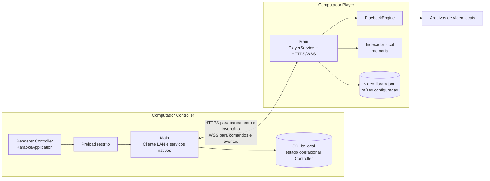
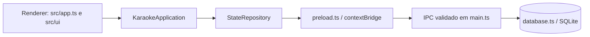
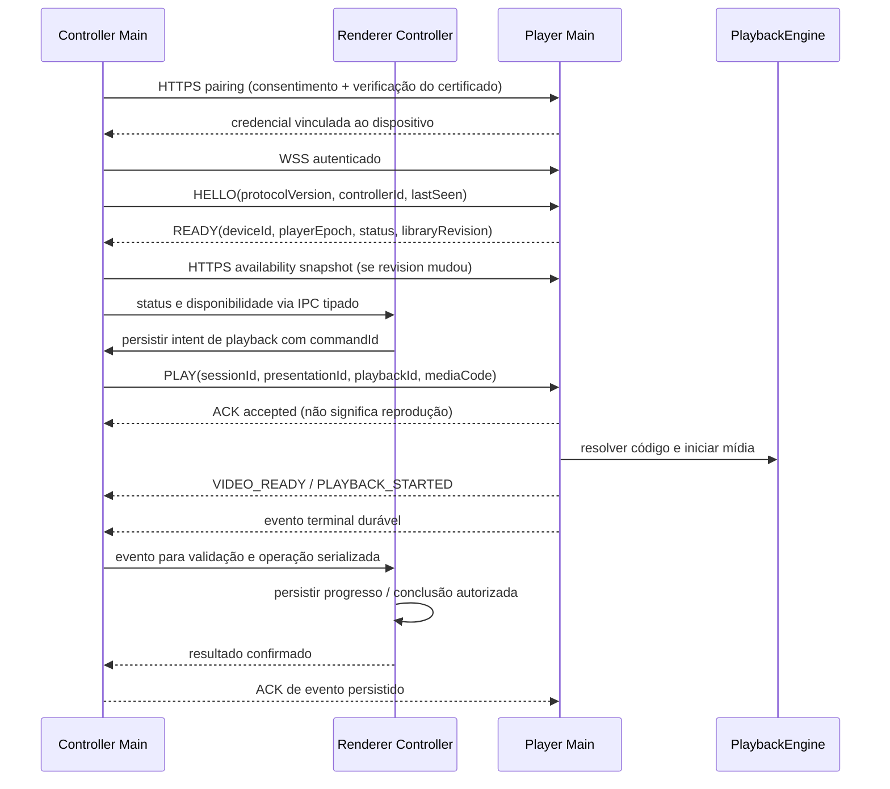
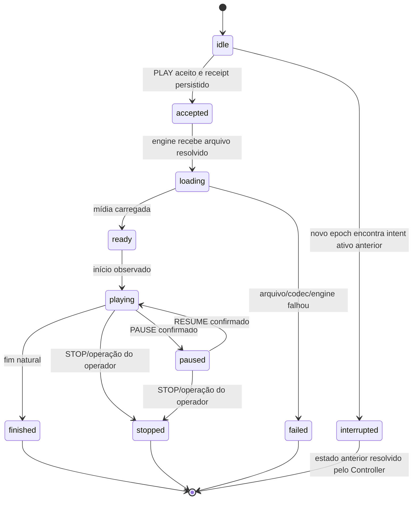

# Arquitetura Remote Player — proposta e status de implementação

**Fases:** 1 — arquitetura e decisões funcionais aprovadas; 2 — modos implementados; 3 — biblioteca local implementada; 4 — catálogo CSV e integração catálogo/inventário implementados; 5C — engine Chromium implementada; 5D — playback manual implementado; 5E — recuperação local implementada; 5F-A — sequência local, catálogo isolado Player e resolução de recovery inválida implementados; 5F-B — UI e janela de reprodução implementadas e validadas em Linux e Windows para Player-only; integração Combined, LAN e automação de apresentações permanecem futuras.
**Branch analisado:** `feature/remote-player-lan-integration`
**Estado deste documento:** arquitetura histórica até a Phase 5F-B; composição Standalone de produção e shutdown integrados na C9.4. O proprietário declarou C9 e a Fase C concluídas/aprovadas em 2026-11-07; limitações históricas de harness/input descritas abaixo não são gates atuais. Questões funcionais remotas ainda abertas estão listadas em [Decisões ainda abertas](#21-decisões-ainda-abertas). Nenhum frame do Doop foi alterado pela implementação.

Este documento preserva a arquitetura aprovada na Fase 1 e distingue implementação verificada de proposta. Modos, índice local de vídeos, catálogo CSV, engine Chromium, playback manual, recuperação local e UI do Reprodutor isolado estão implementados. No startup Player atual, Main abre o shell Standalone e anexa a superfície Chromium de vídeo existente; a antiga janela de controle Player não substitui essa interface. No Combined, a interface/host Player integrado ainda aguarda as fases H. Transporte LAN, pairing, sincronização remota e orquestração autoritativa de apresentações permanecem planejados. Os detalhes estão em [Player Playback](player-playback.md), [Catálogo musical](music-catalog.md) e [Biblioteca local de vídeos](video-library.md).

> **AVISO DE TRANSIÇÃO:** os registros de implementação deste documento continuam sendo referência histórica do código legado. A arquitetura-alvo tem duas funções: Reprodutor (Standalone) e Tudo em um (Combined); Controller independente deixa de ser selecionável, mas seu domínio será preservado para Combined. Conforme a decisão aprovada para a Fase E, a escolha ocorre na primeira abertura do aplicativo, fora da instalação NSIS, pelos frames Welcome aprovados; alteração posterior será exclusivamente pela manutenção do instalador, nunca nas Configurações. A regra aprovada é uma função por computador: E1 audita e obtém aprovação da estratégia; E3 implementa a exclusividade segundo as decisões aprovadas. Propostas antigas de modo, UI e fases estão subordinadas ao [roadmap Standalone/Combined](standalone-player-roadmap.md) e à [especificação V1](standalone-one-screen-player.md). A Fase G entrega a infraestrutura remota; a sequência H integra o domínio de Gestão (H1), Player remoto (H2), autoridade/sincronização operacional (H3), UI pontual (H4), validação (H5), performance (H6) e primeiro release controlado (H7). Playback local integrado ao Combined é H8, posterior e fora do gate de H7. Referências numeradas Phase 5/6/7 neste documento são preservadas como nomenclatura histórica desta proposta.

## 1. Visão executiva

Na arquitetura aprovada, o Controller é a única autoridade sobre sessões, fila, ordenação, apresentações, orquestração de playback e histórico. O Player deverá manter os caminhos de vídeo locais, determinar disponibilidade, executar reprodução e informar eventos observados; ele não poderá recalcular nem gravar a fila operacional do Controller. Somente o fim natural de uma faixa corretamente correlacionada e cujo início foi observado poderá contar como música cantada.

O lifecycle reconhece os três modos. A biblioteca e o protocolo local de mídia são inicializados apenas em Player/Combined; o Controller continua sem varredura local. A Fase 4 acrescentou catálogo no Controller/Combined e associação local com o inventário. Na Fase 5C, Main passou a possuir `PlayerPlaybackService`, enquanto Chromium reproduz em Renderer por `HTMLVideoElement`; a Phase 5F-B anexou esse host a uma janela independente no Player-only. Em startup de Player, o shell ativo é a UI Standalone integrada na C9.4, com a mesma superfície técnica de vídeo e sem iniciar música. Player não abre SQLite Controller; Combined mantém uma só conexão operacional e ainda não abre janela Player.

O Main process deve ser dono de filesystem, SQLite, player engine e serviços LAN. O Renderer continua sendo a interface e, conforme a implementação atual, contém `KaraokeApplication` e `StateRepository`; a futura fronteira de aplicação sem dependência de Renderer é requisito de análise D4.1/D4.2. Serviços nativos apresentam contratos IPC estreitos ao Renderer. Um evento remoto só pode concluir uma apresentação depois de validado e persistido pelo Controller.

Topologia-alvo aprovada, ainda não implementada:



Na arquitetura-alvo local, Combined substitui o `Cliente LAN` pelo adapter local, que chama o serviço Player dentro do processo. Essa composição local corresponde à H8 e vem depois do marco remoto H7. A prioridade atual é a Gestão controlar um Player remoto pelas etapas H2–H7. A Phase 5C já implementa `PlayerPlaybackService` e o adapter Chromium, mas ainda não conecta uma janela de produção nem implementa o adaptador Controller/Player da futura integração de queue; Combined mantém uma única conexão SQLite Controller, sem servidor/socket LAN ou cópia da fila.

## 2. Arquitetura atual verificada

### 2.1 Fluxo e responsabilidades existentes

O fluxo operacional atual é:



- `main.ts` adquire `app.requestSingleInstanceLock()` antes da inicialização operacional, cria a janela e os handlers IPC e abre o banco sob `app.getPath('userData')`.
- A janela atual define `contextIsolation: true` e `nodeIntegration: false`. `preload.ts` expõe métodos específicos de banco, licença, preferências e diagnóstico; não entrega SQL, filesystem nem Node irrestrito ao Renderer.
- `src/app.ts` instancia `KaraokeApplication` e `createRendererStateRepository()`. Portanto, hoje o objeto de aplicação e a coordenação das operações ficam no Renderer; SQLite fica no Main.
- `src/application.ts` serializa mutações completas em `enqueue()`: prepara um candidato a partir do último estado confirmado, persiste antes de publicar e rejeita operações dependentes de uma falha. `completeAndAdvance()` conclui uma apresentação e seleciona o próximo turno numa mesma operação. `getPlayOrder()` é consulta sem persistência.
- `src/state-repository.ts` serializa gravações e reconcilia resultado incerto comparando estado anterior e candidato. Não reaplica uma mutação incerta às cegas.
- `main.ts` chama `validateAppStatePayload()` antes da gravação. `database.ts` mantém as tabelas operacionais e, desde a Fase 4, `music_catalog`/`music_catalog_metadata` em tabelas separadas, com migração até schema 5, SQLite em WAL, `synchronous=FULL`, `busy_timeout=5000` e transações.
- `package.json` configura empacotamento NSIS x64 para Windows; Linux é usado na validação, mas hoje não há target de distribuição Linux declarado.
- `types.d.ts` representa cada apresentação como um `QueueEntry` com `songNumber` e `songNumber2` string. A UI valida número como texto numérico, preservando zeros à esquerda. O banco não modela status separado por música.
- `src/queue-rules.ts`, `src/round-robin-rules.ts`, `src/debut-cadence-rules.ts`, `src/fixed-turn-rules.ts`, `src/frozen-queue-rules.ts` e `src/history-rules.ts` são regras existentes a manter autoritativas.

### 2.2 O que já existe e o que não existe

**Existente antes da Fase 2:** fila inteligente, sessões, histórico, apresentações com uma ou duas músicas, settings existentes, SQLite persistente e lock de instância por perfil `userData`.

**Implementado na Fase 2:** contrato tipado de modos, arquivo de configuração dedicado, validação de leitura/escrita e seleção condicional dos serviços Controller existentes. O detalhamento está em [Lifecycle dos modos implementado](#24-lifecycle-dos-modos-implementado).

**Implementado na Fase 3:** configuração local de raízes e indexador recursivo em memória no processo Main para modos com capacidade Player. O contrato, as condições de disponibilidade e as limitações estão em [Biblioteca local de vídeos](video-library.md).

**Implementado na Fase 4:** parser e validação CSV, substituição transacional do catálogo, busca interna, lookup por código e composição pathless com o inventário local em Combined. Os detalhes estão em [Catálogo musical](music-catalog.md).

**Implementado na Fase 5C:** serviço de playback Main-owned, adapter de host Chromium, Renderer de mídia dedicado, Preload restrito, protocolo local `kq-media` e coordenação de comandos/eventos por tentativa. Testes Electron reais usam essa implementação. A Phase 5F-B conecta esse host à janela independente do modo Player-only; a janela/host Combined continua fora do escopo.

**Implementado na Fase 5D:** `ManualPlaybackService` usa o serviço Chromium existente e a biblioteca Player para validar código textual de 1–5 dígitos, canonicalizá-lo para cinco dígitos e iniciar mídia sem depender de CSV, Controller ou LAN. Next/Previous usam somente sequência explícita; não incrementam códigos nem dão a volta nas bordas. Stop/timeout não são sucesso por ausência de ACK: a contenção tenta Stop limitado e, quando necessário, encerramento confirmado do host Player, sem encerrar a janela Controller ou o app inteiro. Nenhum playback altera fila, apresentação, histórico ou SQLite operacional.

**Implementado na Phase 5E:** `PlayerPlaybackRecoveryStore` mantém um registro local versionado, limitado e validado em `userData`; `PlayerPlaybackRecoveryCoordinator` acompanha o mesmo fluxo serializado do serviço. Intent é durável antes do efeito de playback; EOF e Stop só se tornam terminais depois da validação/ACK e persistência correspondentes. Restart com tentativa ativa/incerta fica pendente e não reproduz automaticamente. Replay, seleção alternativa, dismissal e decisão técnica de shutdown exigem ação explícita e não escrevem histórico/fila Controller. A recuperação distribuída e reconciliação Controller/Player permanecem futuras.

**Implementado na Phase 5F-A:** modo Player isolado habilita avanço automático exclusivamente após `natural-end-candidate` validado para a tentativa atual e quando existe item explícito pendente na sequência local. Stop, Restart, substituição, erro, crash, timeout, EOF duplicado/antigo e recovery pendente não avançam. A sequência segue volátil e não é a fila Controller. Player-only reutiliza parser e catálogo em `player-music-catalog.sqlite`, sem abrir `karaoke.sqlite`; Combined mantém o catálogo na conexão operacional Controller e não autoavança apresentações. Recovery inválida permanece bloqueante até a operação explícita preservar os bytes em quarentena verificável, gravar/relêr estado `idle` e confirmar o término do journal. Main/Preload oferecem contratos tipados e sem caminhos para a UI.

**Implementado na Phase 5F-B (registro histórico):** Player-only ganhou um shell próprio e a superfície de vídeo Chromium; a tela inicial utilizava então `player-control.html`. O painel legado ligava entrada por código, sequência local, controles, estado e progresso a serviços Main-side; biblioteca e CSV usavam armazenamento Player separado. Essa composição foi substituída no startup Player pela UI Standalone integrada na C9.4; os serviços necessários ao Combined e aos fluxos existentes são preservados. Nenhum canvas Doop foi alterado.

**Integrado na C9.4 — composição de produção atual:** no modo player, Main cria a UI standalone-player.html, uma StandalonePlayerSequence, um PlayerPlaybackService, um owner de recovery e o host Chromium existente. A bridge usa o Preload restrito Standalone; biblioteca, catálogo e diálogo nativo continuam Main-owned. A confirmação Sair/X/Alt+F4 passa por uma única coordenação Main-side e shutdown limitado; recovery é verificado antes e depois do dispose, sem EOF artificial ou persistência da sequência. **Limpeza D2:** o shell visual player-control.html e seu preload exclusivo foram removidos. `ManualPlaybackService`, serviços técnicos e os handlers/contratos IPC compartilhados permaneceram para a compatibilidade Controller/Combined; não houve troca de função ou migração. O E2E Linux de produção e o runner Windows nativo oficial passaram com Electron/Playwright, MP4 e SQLite isolado. Windows: branch `feature/remote-player-lan-integration`, HEAD `1404da0d55fb2672cccab065f8af5df0cfa05e5d`, fingerprint `d7c4fea777704df8742cfc88b6560dc343d1c38e6b68d2fb97c7ec722f97e152`; zero processos residuais. Naquele runner, o envio de Alt+F4 não gerou evento `close`, enquanto `WM_SYSCOMMAND/SC_CLOSE` gerou exatamente um. Esse registro é histórico de cobertura; o proprietário aprovou C9 depois, sem solicitar nova execução.

**Correção de playback Main real — 2026-11-06:** a sequência Standalone no Main já reproduzia o vídeo pelo mesmo `PlayerVideoWindow`, mas seu ramo não atualizava o estado do overlay hospedado em `player-playback.html`. Esse host permanecia em `idle` e exibia “Aguardando música” sobre vídeo ativo. Main agora propaga `PlayerPlaybackService.state-changed` para o host e remove a subscription em `will-quit`; a regressão captura a própria `WebContentsView` e confirma painel oculto em reprodução e pausa. O ticket C9 registra testes Linux/Windows, fingerprint e capturas.

**Planejado/não implementado:** transporte HTTP/WebSocket, pairing/autenticação de dispositivos, sincronização remota, UI/host de playback integrado no Combined, interface Controller integrada e reconciliação autoritativa de apresentações. Recuperação remota ainda não existe; recuperação local está implementada. A sequência Standalone é local, volátil e só autoavança em Player-only. Reconhecer extensão ou indexar nomes não comprova compatibilidade de codec. A navegação de reprodução em `src/index.html` continua desativada; a UI Player-only de produção é o shell dedicado `standalone-player.html`.

### 2.3 Garantias e limitações atuais relevantes

As mutações são serializadas dentro de uma instância. O lock bloqueia outra instância que use o mesmo perfil, mas não coordena processos com `userData` diferente, máquinas distintas ou processos externos que abram o mesmo SQLite. Não se deve compartilhar o banco operacional entre Controller e Player nem criar um segundo caminho de escrita para a fila.

`tests/persistence.test.ts`, `tests/persistence-electron.ts` e `tests/multi-instance-electron.ts` cobrem persistência confirmada, recuperação, duplicidade de conclusão e perfis/processos. Os testes de modo cobrem configuração e isolamento em processos Electron reais. A suíte antiga `tests/player-control-electron.ts` foi removida na D2 por depender do shell substituído. As suítes atuais de Standalone incluem `tests/standalone-player-production-electron.ts`, `tests/standalone-player-integration-electron.ts`, `tests/player-playback.test.ts` e `tests/player-playback-electron.ts`, que cobrem produção Main/Preload/IPC, composição, serviços e reprodução Chromium real conforme seus escopos. Nenhuma suíte cobre rede ou pairing. A UI Controller/Combined não é afirmada como integrada ao Player.

### 2.4 Lifecycle dos modos implementado

`src/operating-mode.ts` é a fonte única do tipo `OperatingMode` (`controller | player | combined`), da validação do schema e do mapeamento para capacidades Controller/Player. `main.ts` continua sendo dono do lifecycle Electron e usa essas capacidades para selecionar o que inicializa; não foi adicionada uma camada genérica de composição.

O caminho de startup preserva o lock de instância antes de acessar a configuração. Depois de `app.whenReady()`, o Main lê e valida o modo antes de inicializar `LocalLicenseService` ou abrir SQLite. Logger e crash reporting continuam sendo infraestrutura comum já existente. Configuração inválida gera log fatal e diálogo de erro, interrompe o startup e não abre nem modifica o banco operacional. Se a inicialização falhar depois que a conexão Controller foi aberta, o caminho existente `will-quit` a fecha; `createKaraokeDatabase()` fecha a própria conexão se sua abertura/migração falhar.

| Modo validado | Inicialização atual (com a transição C9.4 aplicada ao Player) |
|---|---|
| Controller | Carrega as preferências visuais existentes, abre a única conexão operacional, registra os IPCs Controller e cria a janela atual. O Renderer continua criando `KaraokeApplication`/`StateRepository` e recuperando a sessão existente. |
| Player | Inicializa licença, biblioteca, `PlayerMediaProtocol`, uma `StandalonePlayerSequence` com um playback/recovery owner e `MusicCatalogService` sobre `player-music-catalog.sqlite`. Não abre `karaoke.sqlite` nem registra IPCs Controller. Cria `standalone-player.html` com Preload/IPC restritos e usa o host `player-playback.html`, sem autoplay. |
| Combined | Inicializa biblioteca, protocolo e uma instância dos serviços Player, além do fluxo Controller existente: uma janela Controller, uma conexão `karaoke.sqlite` e os IPCs atuais. O catálogo usa essa conexão única; Player auto-advance fica desligado e ainda não há janela Player/integração visual Combined. Não cria segunda fila nem segundo writer. |

O lock continua associado ao `userData` atual e é obtido antes da leitura do modo. Um evento `second-instance` recebido antes da resolução mantém a ativação pendente para Controller/Combined; depois que Player é resolvido, a ativação é ignorada. Player-only mantém o processo enquanto a janela Standalone ou janela de vídeo estiver aberta; Controller/Combined seguem o comportamento existente. No encerramento, os serviços Player são descartados; a conexão operacional aberta pelo Controller é fechada sem ser acessada pelo modo Player-only.

Na capacidade de biblioteca da Fase 3, modos Player-capable leem `video-library.json` após resolução do modo e antes de abrir SQLite Controller ou criar janela. Configuração inválida encerra o startup; não é substituída automaticamente e não altera dados SQLite existentes. O scan inicial é aguardado. Em Controller puro, o arquivo não é lido nem as pastas são varridas.

`LocalLicenseService` continua sendo inicializado em todos os modos válidos, sem mudança na política local. Seus IPCs permanecem no ramo Controller; o modo Player ainda não tem interface nem operações licenciadas próprias. A política de licença para futuros serviços Player ainda deverá ser integrada antes de expor essas operações. A garantia de função única por computador, a preservação dos perfis e a compatibilidade de instalações legadas são dependências da Fase E, não garantias do lifecycle atual.

`PlayerPlaybackService` existe em Player e Combined. Em Player-only a Phase 5F-B anexa o host Chromium à janela de vídeo e os controles à janela principal do Reprodutor; em Combined o host/janela continua pendente do design e integração correspondentes. O encerramento Standalone coordena sequence, playback e recovery antes de autorizar quit; protocolo e recursos Main-owned são removidos em `will-quit`. Playback não altera fila/histórico. A recuperação e o catálogo local Player não usam SQLite operacional.

## 3. Modos e propriedade do estado

| Modo | Responsabilidade-alvo aprovada | Estado operacional da fila | Estado da implementação atual (com a transição C9.4 no Player) |
|---|---|---|---|
| Controller | Sessões, mesas, cantores, catálogo, fila, histórico e conexão | Única autoridade local do Controller | Controller e catálogo/busca internos; não inicializa biblioteca, protocolo ou serviço Player |
| Player | Pastas, índice de vídeos e execução local | Não carrega nem altera a fila do Controller | UI Standalone integrada ao startup de produção; host de vídeo e catálogo Player isolado; sem SQLite/IPC Controller |
| Combined | Reutiliza Controller e Player no mesmo processo | Uma única instância de `KaraokeApplication`/persistência | Fluxo Controller, catálogo e serviços locais coexistem; sem segunda conexão SQLite, sequência local ativa ou janela de playback nesta fase |

### 3.1 Configuração e compatibilidade

**Implementado:** `src/operating-mode.ts` define `OperatingMode = 'controller' | 'player' | 'combined'` e persiste a configuração em `operating-mode.json`, sob o `userData` existente, separada do `AppState` e de `ui-preferences.json`. O schema atual aceita somente `{ "version": 1, "mode": ... }`. Arquivo ausente resulta em Controller, preservando instalações antigas sem migração de banco e sem criar o arquivo durante a leitura.

O leitor valida versão e modo por allowlist, exige somente os dois campos conhecidos, limita o arquivo a 4 KiB e decodifica UTF-8 estritamente. JSON inválido, versão/modo desconhecidos, arquivo não regular, conteúdo grande demais ou erro de leitura falham sem fallback para outro papel e sem sobrescrever o arquivo. Main exibe erro e sai antes de inicializar licença ou SQLite; o banco operacional existente permanece intocado.

`writeOperatingModeConfiguration()` valida o valor e grava em arquivo temporário exclusivo no mesmo diretório, sincroniza o arquivo e o renomeia sobre o destino. Em sistemas POSIX, o arquivo recebe permissão `0600`. **Comportamento atual/histórico:** o fluxo de primeira abertura usa esse contrato para salvar a escolha de modo e relança o aplicativo somente para perfil sem configuração e sem dados operacionais anteriores. Perfil legado sem configuração continua em Controller, evitando onboarding que pudesse ocultar dados. A página Settings para trocar de modo não foi integrada e não há troca de papel ao vivo. **Direção futura aprovada:** na E1, a primeira abertura apresentará Reprodutor (`player`) ou Tudo em um (`combined`) no frame Welcome aprovado, sem seleção durante NSIS; a escolha será persistida. Mudanças posteriores somente via manutenção do instalador (E4), nunca nas Configurações normais. A descrição da implementação atual não deve ser tomada como o fluxo-alvo nem alterada antes da fase autorizada.

O modo não altera o caminho de `userData`, do banco ou do lock. Não é necessário chamar `app.setPath()` por modo. A troca de papel deverá entrar em vigor após reinicialização controlada; não encerra uma sessão automaticamente. Em Player, a aplicação não executa operações da fila. Em Combined, há uma única instância Electron e uma única conexão proprietária do estado operacional.

`requestSingleInstanceLock()` continua protegendo o perfil atual. Um Player numa máquina diferente terá seu próprio perfil, identidade e biblioteca locais; esse perfil não é um clone gravável do banco Controller. Em Combined, futuras janelas de saída de vídeo podem ser clientes de status do Main, mas não devem instanciar uma segunda `KaraokeApplication`. Se futuramente forem necessárias várias janelas de Controller, será preciso um serviço de aplicação compartilhado antes de criá-las, pois hoje cada Renderer instancia sua própria aplicação.

Persistência e continuidade:

- `AppState` e histórico do Controller continuam na conexão e no ciclo de persistência existentes.
- O catálogo Controller já reside em tabelas próprias do mesmo SQLite e da mesma conexão Main; o índice de vídeos Player atual é somente em memória. Futuros dados de playback poderão usar essa mesma conexão em transações próprias e não integrarão snapshots da fila quando não forem relacionados.
- Progresso de playback que afeta uma apresentação deve ser persistido no mesmo commit lógico da mudança operacional correspondente. A implementação deve estender o contrato de estado/repositório e sua reconciliação ou fornecer uma operação transacional única por meio da mesma autoridade Main. Não criar um segundo writer do estado operacional.
- A identidade, configuração do modo e segredos não devem ser misturados ao estado da fila. Segredos devem usar armazenamento seguro do sistema; limitações Linux estão em [Segurança](#14-segurança-e-pairing).

## 4. Módulos e limites

Os módulos abaixo mostram fronteiras existentes e futuras. `main.ts` coordena lifecycle e composição no Main, mas parser, catálogo e indexador têm módulos próprios para manter responsabilidades testáveis e não misturadas à fila.

| Módulo ou responsabilidade | Responsabilidade | Motivo / integração atual |
|---|---|---|
| `src/operating-mode.ts` | Validar modos, mapear capacidades e ler/gravar `operating-mode.json` | Implementação transitória atual: schema versionado sob `userData`, default Controller para perfis legados e seleção no primeiro launch de perfil novo. O alvo aprovado é escolha de Reprodutor (`player`) ou Tudo em um (`combined`) na primeira abertura, persistida; troca posterior somente pela manutenção do instalador na Fase E. Exclusividade por computador ainda não está garantida. |
| `src/music-catalog.ts` | Parser CSV puro, validação, normalização, revisão e contratos do repositório | **Implementado:** sem acesso a filesystem, Electron ou SQLite. |
| `src/music-catalog-service.ts` | Leitura segura do CSV, serialização de importações, busca, lookup e associação pathless com inventário | **Implementado:** Main-only; não altera fila. A UI Player-only importa/substitui via diálogo nativo e contrato restrito. |
| `database.ts` (`music_catalog`, `music_catalog_metadata`) | Persistir metadados/revisão do catálogo | **Implementado:** schema 6 na conexão Controller e banco Player-only separado, ambos limitados a tabelas de metadados; substituição é transacional. |
| `src/video-library.ts` | Contratos pathless, parser de código/extension e tipos de snapshot/availability | **Implementado:** reconhece candidatos por nome/extensão; não valida codec nem abre mídia. |
| `src/video-library-configuration.ts` | Validar e persistir raízes em `video-library.json` no `userData` | **Implementado:** schema version 1 e substituição atômica; a UI Player-only seleciona pasta por diálogo Main-side. |
| `src/video-library-service.ts` | Scan seguro, indexação em memória, snapshot e lookup revalidado | **Implementado no Main:** inicializado somente com capacidade Player; detalhes em [video-library.md](video-library.md). |
| `src/player-playback-contracts.ts` | Estados, comandos, observações, erros e eventos internos de playback | **Implementado:** contrato tipado local; ainda não é o protocolo LAN e não inclui estado de fila/apresentação. |
| `src/chromium-playback-host.ts` | IPC Main↔host com autorização do `WebContents`, ACKs correlacionados e eventos | **Implementado:** aceita somente o frame principal esperado, com timeout de readiness/comando e término do host. |
| `player-preload.ts` | Ponte isolada para comandos, observações, ACK e readiness | **Implementado:** API estreita via `contextBridge`; não expõe filesystem, SQLite ou Node ao Renderer. |
| `src/player-playback-renderer.ts` e `src/player-playback.html` | `HTMLVideoElement` e emissão de observações do Chromium | **Implementado:** host técnico sem controles visuais; os eventos são observações reportadas pelo Renderer. |
| `src/player-media-protocol.ts` | Scheme `kq-media`, capacidades opacas e stream local com suporte a Range | **Implementado:** resolve somente código/revisão de inventário; caminho absoluto não cruza IPC. |
| `src/player-playback-service.ts` | Estado e comando serializado no Main, identidade de tentativa e reconciliação dos eventos locais | **Implementado nas Fases 5C–5E:** também chama a persistência de recuperação antes de publicar transições críticas; não toca fila, apresentações, histórico ou SQLite Controller. |
| `src/player-playback-recovery-store.ts` | Registro local versionado e gravação atômica com journal e snapshot anterior | **Implementado na Phase 5E:** reside em `userData`; valida tamanho, schema e coerência sem armazenar caminhos ou histórico operacional. |
| `src/player-playback-recovery.ts` | Projeta estado pendente/resolvido, coordena decisões explícitas e contrato de shutdown | **Implementado na Phase 5E:** integra ao serviço serializado existente; não possui state machine de playback própria nem chama fila Controller. |
| `src/player-ui-contracts.ts` | Snapshot e operações estreitas para UI Player-only | **Implementado na Phase 5F-A/5F-B:** contratos tipados de biblioteca, catálogo, playback, sequência, janela e recovery, sem caminhos locais ou acesso a Node/filesystem no Renderer. |
| `src/player-control-renderer.ts` / `src/player-control.html` / `src/player-control.css` | Shell de operação manual Player-only | **Histórico; removido na D2** por não participar do startup atual e ter sido substituído pelo Standalone. |
| `player-control-preload.ts` | Bridge da UI de controle | **Histórico; removido na D2** junto da interface que consumia exclusivamente essa bridge. |
| `src/player-video-window.ts` | BrowserWindow de saída de vídeo e host Chromium | **Implementado na Phase 5F-B para Player-only:** janela separada, proporção preservada, F11/Esc e sem autoplay; Combined permanece pendente. |
| `src/welcome-renderer.ts` / `welcome-preload.ts` | Seletor dos modos transitórios na primeira abertura | **Implementado na Phase 5F-B, como comportamento atual/histórico.** Para a Fase E, os frames aprovados definem a escolha de função no Welcome durante a primeira abertura, fora do NSIS; a implementação deverá preservar a compatibilidade necessária com modos e dados legados. Não alterar antes da etapa autorizada. |
| `main.ts` | Composição e shutdown de protocolo/serviços conforme modo | **Implementado:** cria serviços Player em Player/Combined; em Player, compõe a UI Standalone e coordena shutdown com confirmação, recovery verificado e cleanup Main-owned; Combined preserva sua UI atual. `before-quit` encaminha a confirmação Standalone e só autoriza quit após coordenação Main-side; Combined preserva o lifecycle existente. |
| Contratos de protocolo | Tipos, versão e validação de mensagens | Fonte única compartilhada por transporte e máquina de estados. |
| Pairing/autorização | Identidade, credenciais, permissão, rotação e revogação | Responsabilidade de segurança separada de sockets e fila. |
| Transporte LAN | Servidor HTTPS/WSS no Player e cliente no Controller | Possui ciclo de vida e falhas de rede; opera somente no Main. |
| PlaybackEngine genérico | Interface intercambiável de engines | **Não implementado:** a Fase 5C usa diretamente o adapter Chromium; não foi criado framework de plugins. |
| `ManualPlaybackService` local | Validar/canonicalizar código, chamar playback local e navegar sequência explícita | **Implementado nas Fases 5D/5F-A/5F-B:** serviço Main-side sem state machine/fila própria; sequência volátil com add/remove/reorder/clear e auto-advance somente em Player-only após EOF válido. UI conectada; persistência, adaptação remota e orquestração Controller permanecem futuras. |
| Orquestrador de playback do Controller | Liga apresentação, comandos, eventos e persistência | Mantém autoridade no fluxo serializado de `KaraokeApplication`; não reimplementa regras de fila. |
| Adaptadores LAN e local | Implementam a mesma capacidade de player remoto | O adapter LAN atende à prioridade remota H2–H7; o adapter local de Combined pertence à H8, depois do primeiro release. |
| IPC explícito | Operações e eventos mínimos para Renderer | Estende o padrão de `preload.ts` e `types.d.ts`, sem API genérica. |

**Caminho do estado no Controller:** a nova coordenação de apresentação deve entrar em operações serializadas da aplicação atual. O transporte Main valida e encaminha eventos ao Renderer por APIs explícitas; só confirma ao Player a recepção de evento depois que o Controller persistiu o resultado. Não mover as regras de fila para o socket nem permitir que um evento atualize a UI como concluído antes do commit.

## 5. HTTP e WebSocket

O Player expõe o serviço; o Controller inicia a conexão. Os dois lados mantêm comunicação bidirecional autenticada. Endereços podem ser inseridos pelo operador na primeira versão; descoberta automática/mDNS fica fora do necessário inicial.

### 5.1 Responsabilidades por transporte

| Transporte | Responsabilidades recomendadas |
|---|---|
| HTTPS | Pairing inicial; health mínimo sem dados sensíveis; consulta autenticada do inventário de códigos por `libraryRevision`. Não transmite mídia. |
| WSS | HELLO/READY, snapshot do status atual, comandos de playback, acknowledgements, eventos, heartbeat e recuperação da sessão ativa. |

`GET_STATUS` deve ser mensagem request/response no WSS. Ao conectar, `READY` já inclui status atual e `libraryRevision`; o Controller busca os códigos por HTTPS quando a revisão é nova. A lista de códigos usa apenas números de música, nunca caminhos. Uma alteração de índice anuncia nova revisão no WSS; o Controller atualiza o snapshot HTTP. Isso evita duplicar duas APIs equivalentes de controle/status.

Rotas candidatas, todas HTTPS e autenticadas exceto health mínimo e o início do pairing:

- `GET /v1/health`: versão de protocolo e disponibilidade mínima; sem identidade privada, caminhos ou status operacional detalhado.
- `POST /v1/pairings`: troca inicial de solicitação/consentimento e emissão de credencial somente depois da confirmação do certificado e do operador.
- `GET /v1/library/codes?revision=<known>`: snapshot autenticado dos códigos da revisão; retorna `not-modified` quando igual. A resposta pode ser comprimida; paginação só deve entrar se o volume medido exigir.
- `WSS /v1/control`: sessão bidirecional de controle e eventos. Comandos, status, HELLO/READY, heartbeat e eventos não ganham rotas HTTP paralelas.

Todas as rotas úteis, inclusive status e WebSocket, exigem autenticação depois do pairing; `Origin`/CORS são defesas adicionais, não credenciais.

### 5.2 Conexão e sincronização



No caminho local de Combined, planejado para H8, a seta de `PLAY` vai ao `LocalPlayerAdapter`; ele chama o mesmo serviço e devolve os mesmos contratos/eventos sem HTTPS/WSS. Esse caminho não faz parte do primeiro release remoto H7.

## 6. Contrato de protocolo proposto

Protocolo JSON versionado, com schema validado em cada borda. Exemplo ilustrativo para documentação; não é TypeScript de produção:

```ts
type CatalogCode = string // código CSV original: 1–5 dígitos ASCII, sem zero inicial
type MediaCode = string   // prefixo de vídeo: exatamente 5 dígitos ASCII

type CatalogEntry = {
  catalogCode: CatalogCode
  artist?: string
  title?: string
  mediaCode?: MediaCode   // derivado apenas para matching/disponibilidade
}

type PlayPayload = {
  controllerId: string
  deviceId: string
  sessionId: string
  presentationId: string        // ID QueueEntry/turno já existente
  playbackId: string            // uma execução individual de música
  mediaCode: MediaCode
  trackIndex: 1 | 2
  issuedAt: number              // diagnóstico; nunca ordena eventos
}

type Request<T> = {
  protocolVersion: 1
  requestId: string              // ID de consulta; em comando mutável equivale a commandId
  type: 'HELLO' | 'GET_STATUS' | 'SESSION_CHANGED' | 'PLAY' | 'PAUSE' | 'RESUME' | 'RESTART' | 'NEXT' | 'PREVIOUS' | 'STOP' | 'SET_VOLUME'
  payload: T
}

type Response<T> = {
  protocolVersion: 1
  responseTo: string             // requestId correlacionado
  type: 'READY' | 'STATUS' | 'COMMAND_ACK' | 'ERROR'
  payload: T
}

type CommandAckPayload = {
  result: 'accepted' | 'rejected'
  playerEpoch: string
  error?: { code: string; retryable: boolean }
}

type PlayerEvent = {
  protocolVersion: 1
  type: 'VIDEO_READY' | 'PLAYBACK_STARTED' | 'PLAYBACK_PAUSED' | 'PLAYBACK_RESUMED' |
        'PLAYBACK_FINISHED' | 'PLAYBACK_STOPPED' | 'PLAYBACK_FAILED' | 'PLAYBACK_INTERRUPTED'
  deviceId: string
  playerEpoch: string
  sequenceNumber: number
  sessionId: string
  presentationId: string
  playbackId: string
  mediaCode: MediaCode
  trackIndex: 1 | 2
  occurredAt: number            // diagnóstico; pode haver clock drift
  reason?: 'natural' | 'operator' | 'controller' | 'missing' | 'unsupported' | 'engine-error' | 'process-restarted'
}

type EventAck = {
  protocolVersion: 1
  type: 'EVENT_ACK'
  playerEpoch: string
  sequenceNumber: number
  result: 'persisted' | 'already-applied' | 'stale-but-recorded'
}
```

`PlayPayload` é somente o payload de `Request<T>`; tipo, versão e correlação pertencem ao envelope. Há uma única representação serializada por comando. Um ACK de comando é `Response<CommandAckPayload>` com `type: 'COMMAND_ACK'`. `HELLO` e `GET_STATUS` usam `requestId`; a resposta repete esse valor em `responseTo`. `GET_STATUS` pode consultar o status atual e o receipt de um `commandId` específico. Em comandos mutáveis, `requestId` é também o `commandId` estável usado para dedupe e retry; portanto `responseTo` identifica o `commandId` no ACK. Eventos do Player são correlacionados por `deviceId + playerEpoch + sequenceNumber`; `EVENT_ACK` só é emitido depois de o Controller persistir/aplicar o evento ou registrar duravelmente que ele é obsoleto.

### 6.1 Significado dos identificadores

- `protocolVersion`: versão maior do contrato; versão desconhecida é recusada antes de executar ação.
- `deviceId`: identidade estável do Player; não é credencial.
- `controllerId`: identidade do Controller pareado, usada em autorização/revogação.
- `sessionId` e `presentationId`: validam que o evento ainda pertence ao turno/sessão corrente.
- `playbackId`: uma tentativa de executar uma música; duas músicas da mesma apresentação têm IDs diferentes.
- `commandId`: identifica uma intenção de comando para dedupe e retry seguro.
- `catalogCode`: valor original do CSV, 1–5 dígitos sem zero inicial; é mantido como string e nunca convertido para `number`.
- `mediaCode`: código de cinco dígitos do prefixo do arquivo; é enviado ao Player e ecoado nos eventos para localizar/correlacionar mídia. O Controller pode associá-lo ao `CatalogCode` sem tornar metadados obrigatórios.
- `playerEpoch`: UUID novo a cada inicialização do Player, para delimitar eventos e status de um processo.
- `sequenceNumber`: inteiro monotônico de evento dentro do epoch; duplicado é descartado e lacuna provoca sincronização de status.
- `issuedAt`/`occurredAt`: horário de diagnóstico apenas. Relógios de máquinas diferentes não definem causalidade.

`HELLO`/`READY` estabelecem versão compatível, dispositivo, `playerEpoch`, playback observado e revisão da biblioteca. `GET_STATUS` request/response é seguro e não modifica a execução. `PLAY`, `PAUSE`, `RESUME`, `RESTART`, `NEXT`, `PREVIOUS`, `STOP` e `SET_VOLUME` são comandos autorizados e correlacionados por `commandId`. O ack indica somente aceitação/rejeição da intenção. `VIDEO_READY` indica arquivo encontrado e carregado; `PLAYBACK_STARTED` comprova início observado. NEXT/PREVIOUS referem-se a músicas, nunca a timestamps; seeking não faz parte do escopo inicial.

`SESSION_CHANGED` é uma cerca depois da troca de sessão, não um comando para interromper playback. A troca fica bloqueada enquanto houver reprodução ativa ou resultado incerto. O operador deve parar/interromper explicitamente e aguardar confirmação ou reconciliação conclusiva antes da mudança; não se envia STOP automaticamente como efeito colateral da troca. Só então o Controller informa o novo `sessionId`, invalida intents antigos não enviados e Player rejeita comandos de outra sessão. No reconnect, `HELLO` leva o `currentSessionId` autoritativo antes de liberar retries; se não for possível provar que playback antigo terminou/parou, o estado permanece incerto e nenhum novo PLAY é enviado.

Eventos terminais distintos:

- `PLAYBACK_FINISHED`: candidato a fim natural observado pelo engine; o evento isolado/EOF/end-file não prova que a música foi cantada.
- `PLAYBACK_STOPPED`: interrupção intencional por operador/Controller; nunca significa sucesso.
- `PLAYBACK_FAILED`: falha ao achar, abrir, decodificar ou tocar o arquivo.
- `PLAYBACK_INTERRUPTED`: o Player reiniciou com um intent local ainda ativo; reporta interrupção/resultado desconhecido, nunca fim natural.
- Desconexão Controller–Player não muda o estado local do engine. O Controller marca o último status como desatualizado/desconhecido e consulta novamente.

Envelope de erro inclui `code` estável, `retryable`, `commandId` quando houver e mensagem segura para operador. Códigos mínimos: `AUTH_REQUIRED`, `NOT_AUTHORIZED`, `VERSION_UNSUPPORTED`, `INVALID_MESSAGE`, `PLAYER_BUSY`, `STALE_SESSION`, `MUSIC_CODE_NOT_AVAILABLE`, `FILE_MISSING`, `UNSUPPORTED_MEDIA`, `ENGINE_ERROR` e `OUTCOME_UNKNOWN`. Não retornar caminhos absolutos.

Mensagens desconhecidas, payloads inválidos, versões incompatíveis e comandos de sessão antiga não provocam transição. O mesmo `commandId` com mesmo payload retorna o resultado já conhecido e não inicia outro playback; o mesmo ID com payload diferente é rejeitado. Ação intencional nova recebe novo ID. `PAUSE`, `RESUME` e `STOP` nomeiam o `playbackId` e são comandos de estado idempotentes; `SET_VOLUME` define um valor absoluto, nunca um incremento. `PLAYBACK_STOPPED` só é emitido quando o engine confirma que a execução parou. Se o playback já terminou naturalmente, STOP retorna/reconcilia status terminal `finished` e preserva o evento natural no outbox; não sintetiza um `PLAYBACK_STOPPED` posterior. Uma lacuna de `sequenceNumber` exige `GET_STATUS`/reconciliação antes de aceitar eventos posteriores; timestamps não resolvem a lacuna.

O Player retém receipts/tombstones de `commandId` e `playbackId` para a sessão ativa, inclusive depois do término, até a troca de sessão ser confirmada e não existir playback/outbox pendente associado. O Controller invalida comandos ainda não enviados na troca de sessão e comunica a sessão atual antes de enviar novos comandos. Comandos antigos são rejeitados depois que o Player aprende a nova sessão. A implementação precisa definir limpeza segura; não pode remover um tombstone enquanto um retry ainda puder reiniciar aquela faixa.

## 7. Playback e integração com a fila

O diagrama e os contratos de integração Controller/Player desta seção foram propostos sob a antiga Phase 7 desta arquitetura, nomenclatura histórica preservada. Na ordem atual do roadmap, a integração remota da Gestão está em H2/H3, a validação operacional remota em H5 e a reprodução local integrada em H8, depois do primeiro release controlado H7. Hoje `ManualPlaybackService` resolve código canônico e controla a engine local. No Player-only, a sequência explícita e volátil dá suporte a Next/Previous e pode avançar automaticamente depois de EOF natural validado. Esse avanço local não controla apresentação Controller: o serviço não recebe IDs de apresentação/sessão, não altera fila nem persiste histórico. A UI Player-only conecta esse serviço em um shell próprio; o contrato e a máquina estão em [Player Playback](player-playback.md).



Esse diagrama representa estados observados pelo Player/engine. Estado de conexão e conhecimento do Controller são dimensões separadas: Controller pode marcar seu snapshot como `stale/unknown` ao perder conexão enquanto o Player segue localmente em `playing`. Se o processo Player reinicia com intent ativo sem evento terminal durável, ele reporta playback interrompido/resultado desconhecido no novo epoch; não retoma sozinho nem conclui.

Controles do operador: Play/Resume, Pause, Restart, Next, Previous e Stop/Cancel quando aplicável. NEXT/PREVIOUS navegam entre músicas, nunca timestamps; seeking na timeline ou saltos arbitrários dentro do vídeo ficam fora do escopo inicial. Restart e navegação manual invalidam a geração anterior do playback sem criar outra apresentação/turno, concluir música ou duplicar histórico. A política futura de avanço é configurável e persistida, com padrão `Automatic`: após fim natural da faixa 1 de uma apresentação com duas músicas, inicia a faixa 2; após a última faixa natural, pode iniciar a próxima apresentação permitida pelas regras da fila. Em `Manual`, aguarda ação do operador depois de cada faixa que terminar naturalmente, mantendo a apresentação pendente quando ainda houver faixa requerida.

### 7.1 Uma ou duas músicas por apresentação

Uma apresentação continua sendo um turno e pode conter uma ou duas músicas. Cada música tem `playbackId` e índice 1 ou 2. O fim natural da primeira música persiste progresso da apresentação e permite pedir a segunda, se existir. O Controller só chama a operação equivalente a `completeAndAdvance()` depois do fim natural de todas as músicas requeridas. O evento de término de uma música nunca conclui diretamente o turno.

Cada faixa possui ciclo e histórico individual. EOF/end-file é apenas candidato, não evidência suficiente de canto, mesmo com início observado, correlação correta a `playbackId`, `trackIndex`, `presentationId` e `sessionId`, e sem erro reportado: mídia truncada/incompleta pode alcançar EOF sem erro explícito. Antes de implementar um engine, definir um critério adicional de integridade/fim completo apropriado a ele; duração e erro do decoder são evidências possíveis, não regras decididas nesta fase. Enquanto evidência suficiente não existir, manter resultado `UNKNOWN` e pedir resolução operacional. O contrato do engine também precisa distinguir fim natural de stop, substituição de arquivo, erro e término interrompido. Essa cautela corresponde à semântica documentada pelo [manual mpv](https://mpv.io/manual/stable/) e não antecipa resultado do spike. A apresentação só termina depois do sucesso natural validado de todas as faixas requeridas. Falha da segunda faixa não completa a apresentação. Pause, restart, NEXT/PREVIOUS, STOP, cancelamento, falha, timeout de rede e crash são eventos operacionais, nunca conclusão musical. Não criar automaticamente uma apresentação por faixa.

### 7.2 Ciclo e fronteira de persistência

1. O Controller confirma qual `sessionId` e `presentationId` estão ativos.
2. Seleciona a faixa correspondente e gera `playbackId` e `commandId` estáveis.
3. A operação serializada persiste intent/outbox e correlação antes do envio ao Player, distinguindo ao menos `pending`, `dispatching/uncertain` e `accepted`. Ela retorna após a persistência confirmada, sem aguardar a rede ou o ACK remoto.
4. Depois do commit, um dispatcher único por Player no Main consome o outbox em segundo plano. O outbox guarda uma ordem monotônica persistente por Player; só há um comando mutável em voo. Isso preserva FIFO após restart/reconnect e evita inversão de comandos. Antes de enviar o próximo item, o dispatcher consulta por IPC tipado a aplicação para reivindicar o intent somente se sessão, apresentação e intent continuarem atuais; a reivindicação é uma operação serializada curta e persistida, não espera resposta de rede. O dispatcher envia pelo `PlayerControlPort` e só avança depois do receipt/ACK ou reconciliação conclusiva. Em timeout/crash incerto, reconcilia ou reenvia o item da cabeça com os mesmos IDs; comandos posteriores permanecem atrás dele. Troca de sessão não pode ocorrer durante reprodução ativa/incerta: após interrupção explícita confirmada, a operação invalida intents antigos e coloca `SESSION_CHANGED` como cerca durável, sem STOP implícito. `commandId` deduplica; não define ordenação.
5. Player registra receipt antes de qualquer efeito de reprodução e antes de confirmar `accepted`.
6. ACK, vídeo carregado, início, pausa e fim são estados separados.
7. Eventos passam por schema, autenticação, epoch, sequência, sessão, apresentação e faixa. Outbox antigo conserva seu `playerEpoch` e sequência originais; após reconexão o Controller só o aceita se ainda corresponder a intent persistido e não confirmado, reconciliando status atual antes de agir. O Controller só aplica eventos em sequência contígua por epoch; diante de qualquer lacuna, segura os posteriores e reconcilia/recarrega o outbox antes de aceitar um terminal. Para cada `playbackId`, o primeiro evento terminal válido na sequência do Player que a operação serializada confirma e persiste vence; eventos terminais concorrentes ou posteriores são registrados como obsoletos e não alteram a conclusão.
8. `main.ts` encaminha evento por IPC explícito ao Renderer que contém `KaraokeApplication`. A operação serializada persiste progresso da faixa, identidade do evento aplicado e, no último término, conclusão da apresentação/avanço em uma única transação SQLite. O Main espera o resultado confirmado; se Renderer não responder ou a persistência for incerta, não envia `EVENT_ACK`. Player mantém/retransmite evento pelo outbox.
9. Cancelamento ou STOP manual é explícito e nunca marca a faixa como cantada. A apresentação só pode seguir o caminho de cancelamento existente após confirmação/reconciliação terminal; evento natural anterior, se comprovado na sequência do Player, conta apenas aquela faixa. Sem confirmação ou prova reconciliada, mantém resultado incerto e não avança.
10. No restart, se intent/outbox Controller estiver pendente e o Player não registrar o `commandId`, Controller reenvia exatamente os mesmos IDs. Se Player tiver receipt ou estado de execução, reconcilia e não inicia outra vez; se a evidência for inconclusiva, aguarda operador. Nunca gera novos IDs para repetir uma intenção incerta.
11. O modelo persistente futuro registra cada sucesso de faixa com chave/correlação de `playbackId` e `trackIndex`, além de `presentationId`/`sessionId`; o log operacional fica separado e guarda restart, navegação manual, cancelamento, STOP, falhas e interrupções, sem aumentar contagem de músicas cantadas. Apenas após todos os índices/faixas requeridos terem sucesso natural o Controller consolida `doneAt`/conclusão da apresentação e usa o caminho existente para avançar o turno. A preferência futura `Automatic | Manual`, persistida quando implementada, terá padrão `Automatic`: após fim natural da faixa 1, inicia a faixa 2; após cada faixa natural, `Manual` aguarda a ação do operador, deixando a apresentação pendente se restarem faixas; após a última faixa natural aguarda a decisão do operador para a próxima apresentação. Em qualquer modo, STOP, cancelamento, falha e pulo manual nunca provocam avanço automático. Restart/replacement cria geração de playback nova; eventos antigos dessa execução são obsoletos e não duplicam apresentação, turno ou histórico. As regras Round Robin, debut, pin e freeze não são recalculadas pelo Player.

O contrato persistente de playback deve incluir no mínimo intent ativo, IDs correlacionados, sucessos naturais por `playbackId`/`trackIndex`, `doneAt` consolidado somente depois de todas as faixas requeridas, log operacional separado, último evento aceito e estado incerto. O esquema atual não contém esses dados; isso exigirá migração e extensão da validação do estado. O journal precisa ser atualizado no mesmo limite transacional da operação da fila que conclui/cancela, sem segunda conexão gravadora.

## 8. Catálogo CSV implementado

O contrato de parser, armazenamento, importação, busca e integração com o índice está em [Catálogo musical](music-catalog.md). A fonte do catálogo é metadado; a disponibilidade de reprodução continua pertencendo ao inventário Player. A Fase 4 implementa os serviços internos, mas não cria telas, IPC de importação/busca nem altera o fluxo de inclusão na fila.

### 8.1 Dados e validação

`src/music-catalog.ts` aceita UTF-8 estrito com BOM opcional, delimitador `;` ou `,` identificado pelos cabeçalhos lógicos exatos `artista`, `numero` e `nome_musica`, aspas/aspas escapadas, campos delimitados, linhas LF/CRLF e campos citados multilinha. Rejeita cabeçalho ausente/ambíguo, quoting inválido, coluna extra/ausente, UTF-8 inválido, controles inválidos, código duplicado/malformado, catálogo vazio ou limites excedidos. O arquivo é limitado a 32 MiB, cada campo a 4.096 caracteres e o catálogo a 100.000 registros.

O código CSV permanece como string original de 1–5 dígitos ASCII sem zero à esquerda; nunca é convertido em número. Uma função única o preenche com zeros à esquerda para produzir o código canônico de vídeo de cinco dígitos. Artista e título são opcionais (`null` quando vazios), normalizados para NFC e espaços consistentes; formas de busca removem marcas diacríticas sem alterar o texto apresentado. Campos inesperados não são usados para inferir metadados.

### 8.2 Armazenamento, atomicidade e concorrência

O Controller é dono do catálogo; `database.ts` o guarda nas tabelas separadas `music_catalog` e `music_catalog_metadata`, schema SQLite v5, usando a mesma conexão já aberta para o estado operacional Controller. O Player não abre o SQLite do Controller. Combined reutiliza um único banco e o mesmo serviço de catálogo. A migração de schemas v1–v4 é sequencial e preserva tabelas operacionais.

Cada importação válida substitui integralmente o catálogo anterior. Leitura, parse e validação do arquivo ocorrem antes da transação; a substituição das linhas e da revisão/contagem ocorre numa única transação SQLite. Falha mantém a revisão anterior e não altera sessões, fila, apresentações, histórico, licenciamento ou arquivos de vídeo. Importações são serializadas na ordem de solicitação do começo da leitura até o commit. Shutdown impede novas importações e aguarda as já aceitas. Buscas leem linhas e revisão no mesmo snapshot.

As revisões do catálogo são hashes SHA-256 do conteúdo semântico normalizado do dataset; reimportar o mesmo conteúdo mantém a mesma revisão, embora o horário de importação possa avançar. Caminhos CSV não são persistidos. O leitor Main-only limita tamanho, rejeita arquivos não regulares e links/reparse detectáveis, e confere identidade, tamanho e timestamps de alta precisão antes/depois da leitura; uma alteração observada resulta em `FILE_CHANGED`. Isso reduz corrida de edição local, mas não é snapshot atômico garantido contra qualquer writer de filesystem.

### 8.3 Busca e relação com a fila

`MusicCatalogService.search()` oferece busca literal parcial e case/accent-insensitive em artista e título e busca por prefixo nos códigos, com paginação limitada (padrão 50, máximo 100 por página) e ordenação determinística pelo código original. `%` e `_` são caracteres literais. Busca vazia retorna zero itens. A busca não carrega cópia integral do catálogo para o Renderer; as consultas usam parâmetros SQLite. A busca textual percorre metadados normalizados no SQLite (`instr`); não foi introduzido FTS5 para o catálogo atual de aproximadamente 14 mil itens.

`lookupByVideoCode()` resolve um código diretamente, ainda que não haja registro CSV, e associa dados pathless com o inventário local quando disponível. Esse lookup permite consultar vídeo sem metadados, sem criar artista/título fictícios. Disponibilidade sem Player conectado ou sem inventário confiável é `unknown`; ausência só é `missing` depois de scan completo; duplicatas seguem `ambiguous`.

Busca por artista, título ou código é somente uma capacidade de descoberta/consulta de código e disponibilidade. **Ela nunca cria fila, turno ou apresentação.** O fluxo existente de inclusão permanece baseado no número/código informado. Um resultado de busca só entra na fila se o operador usar separadamente o fluxo atual de código. O serviço de catálogo não depende de `KaraokeApplication` nem modifica fila/histórico.

## 9. Biblioteca de vídeos e matching

**Status:** configuração, reconhecimento de candidatos, scan e inventário local estão **IMPLEMENTED** conforme [video-library.md](video-library.md). A associação local com metadados do Controller/Combined está **IMPLEMENTED** na Fase 4. O índice continua somente em memória e não existe disponibilidade remota ou reprodução implementada.

### 9.1 Pastas, indexação e disponibilidade

- **Implementado:** raízes são configuração local em arquivo e o scan é inicial/explicito pelo serviço. A UI Player-only da Phase 5F-B permite escolher a pasta e solicitar reindexação por diálogo Main-side; a UI correspondente para Combined ainda não está integrada.
- **Implementado:** indexador recursivo ignora symlinks/reparse points, mantém índice apenas em memória e expõe inventário/diagnósticos pathless. Não há banco local de Player nem persistência dos caminhos/index.
- Nome de vídeo deve começar com exatamente cinco dígitos ASCII (o `MediaCode`), seguido por extensão ou separador/texto descritivo, por exemplo `01001 - descrição.mp4`. Um sexto dígito contíguo torna o prefixo malformado; não aceitar menos de cinco dígitos nem código em outra posição. Verificar extensão de forma independente.
- `MusicCatalogService` compara o código canônico de cinco dígitos com `videoCode` do catálogo. O código CSV original é preservado. A busca não depende de nomes de arquivo nem infere artista/título do nome; não converte identificadores em quantidades numéricas.
- Mais de um arquivo para o mesmo código torna o código **ambíguo e indisponível** até o operador resolver. Não escolher o “primeiro” por ordem do filesystem.
- Varredura só publica nova revisão depois de concluída. Se diretório ficar ilegível ou ocorrer falha parcial, preservar o último índice válido e mostrar que está desatualizado.
- Antes de reproduzir, resolver o caminho novamente dentro das raízes canônicas, confirmar arquivo regular, extensão permitida e existência. Indexação não é garantia de codec compatível.
- Um arquivo movido/removido deixa de estar disponível após nova varredura; se desaparecer entre indexação e execução, o Player responde `FILE_MISSING` sem expor o caminho. Erro de decode resulta em `UNSUPPORTED_MEDIA`/`ENGINE_ERROR`.

### 9.2 Armazenamento e limites

**Implementado:** as raízes ficam em `video-library.json`; os candidatos e o snapshot residem somente na memória do processo Player. Não existe `player_roots`, `player_media` ou journal SQLite. Controller puro não lê a configuração; Combined usa o mesmo serviço local do processo e mantém sua única conexão Controller.

O catálogo Controller é persistido em SQLite v5, separado das tabelas operacionais, usando a conexão Controller existente. A biblioteca Player continua somente em memória; não cria writer SQLite separado. A sincronização futura deve transmitir somente códigos/revisões pathless, nunca caminhos completos.

O índice de vídeos é a fonte de verdade de disponibilidade para reprodução. O serviço local mantém códigos descobertos e classifica duplicatas sem escolher arquivo arbitrariamente. Vídeo sem CSV permanece consultável pelo código e não recebe metadados inventados; CSV sem vídeo confirmado não é reportado como reproduzível. Disponibilidade observada não promete decode.

## 10. Integração de catálogo e Player

O Controller mantém o catálogo operacional CSV e os metadados pesquisáveis na sua conexão SQLite. Player-only também permite catálogo CSV opcional: reutiliza `MusicCatalogService` e parser, mas persiste somente as duas tabelas de catálogo em `player-music-catalog.sqlite`, sem abrir o SQLite operacional Controller. O Player mantém o índice local de arquivos e a disponibilidade. **Em Combined**, a associação local deriva a view pathless do catálogo Controller e do inventário Player; não persiste estado de vídeo no catálogo. **Em Controller-only**, ainda não há LAN e disponibilidade fica `unknown`.

- CSV sem vídeo confirmado: item não reproduzível (`missing`);
- Player desconectado, revisão stale ou inventário ainda não sincronizado: disponibilidade `unknown`, não declarar ausência confirmada;
- vídeo sem CSV: código disponível e reproduzível sem artista/título, não criar metadados;
- Player alterou pastas: o serviço local gera uma nova revisão de inventário após rescan. Anúncio remoto e sincronização de revisão são futuros;
- Controller offline: Player continua localmente; não recebe filas para executar;
- reconexão: `READY` inclui estado ativo e revisão; sincronizar antes de enviar outro PLAY (protocolo futuro);
- música ficou indisponível após sincronização: Player verifica novamente e rejeita; Controller mantém a apresentação pendente e oferece resolução operacional;
- Combined com playback local integrado (H8): usa o Player local diretamente, sem socket LAN; antes de H8, não presumir fallback local no fluxo remoto nem exibir desconexão fictícia.

É possível pesquisar metadados no Controller mesmo sem Player conectado. A disponibilidade fica desconhecida. O resultado de busca não adiciona música à fila: a inclusão continua no fluxo existente baseado em código. A regra de admissão de uma faixa CSV sem vídeo confirmado permanece decisão aberta; nenhuma apresentação é concluída por ausência/falha do vídeo.

## 11. Falhas, recuperação e dados

| Cenário | Política proposta |
|---|---|
| Player indisponível/desconectado | Controller mantém fila e sessão; sem auto-advance. Exibe disponibilidade como desconhecida/desatualizada. |
| ACK perdido / timeout do PLAY | Não criar outro comando nem avançar. Reconectar e consultar status usando o mesmo `commandId`/`playbackId`. |
| WebSocket reconecta com vídeo ativo | Player envia `READY` com epoch, playback e posição/status; Controller adota apenas se corresponder ao intent persistido. |
| Player reiniciou | Novo `playerEpoch`; engine normalmente não retoma sozinho. Outbox conserva epoch/sequence originais e reenvia eventos terminais até ack. Controller só aplica evento antigo se ele estiver no journal autenticado e ainda corresponder ao intent; sem prova, marca resultado como `UNKNOWN` e aguarda resolução. |
| Controller reiniciou | Carrega intent/progresso persistidos, reconecta e reconcilia antes de emitir comando. Player pode continuar tocando durante indisponibilidade. |
| Controller caiu após o Player terminar | Player mantém evento terminal num outbox local até receber confirmação durável do Controller; reenvio usa mesma sequência/event ID. |
| Evento duplicado | Deduplicar por `(deviceId, playerEpoch, sequenceNumber)` e por `playbackId`; resultado não avança novamente. |
| Evento fora de ordem/lacuna | Não inferir ordem pelo timestamp; reconciliar `GET_STATUS`, consumir o outbox e ignorar evento obsoleto apenas depois de persistir sua resolução. |
| Solicitação de troca de sessão durante playback ativo/incerto | Bloquear a troca. Operador interrompe explicitamente e aguarda confirmação/reconciliação; nunca enviar STOP automaticamente como efeito da troca. Depois de playback resolvido, persistir mudança e enviar `SESSION_CHANGED` apenas como cerca. |
| Falha, STOP, skip ou restart | Registrar como evento operacional, não como música cantada nem conclusão. Operador resolve; nenhuma dessas ações provoca avanço automático. |
| SQLite incerto no Controller | Usar reconciliação de `StateRepository`; não enviar ACK de evento nem repetir mutação antes de provar o estado. |
| Indexação incompleta | Preservar índice válido anterior; marcar status desatualizado. Nunca apagar todos os vídeos por falha transitória. |

**Implementado localmente na Phase 5E:** o Player grava intent e estado terminal em `player-playback-recovery.json` sob `userData`, por meio de `PlayerPlaybackRecoveryStore` e `PlayerPlaybackRecoveryCoordinator`. Tentativa ativa/pausada/incerta no restart vira `pending`, sem autoplay; Stop só é terminal depois de ACK, e EOF só é publicado depois da persistência durável. O coordenador oferece replay com nova tentativa, seleção de outra música e resolução como parado, sempre correlacionados ao attempt atual. Isso não grava canto/apresentação e não usa o SQLite operacional do Controller. Os registros inválidos/desconhecidos são preservados e bloqueiam playback novo.

As categorias de persistência abaixo descrevem o desenho distribuído proposto para as fases futuras. A implementação local da Phase 5E não é um outbox LAN e não persiste histórico de música cantada:

**Persistente:** catálogo e hash da importação no Controller; raízes e índice local no Player; IDs/estado de intent, sucessos naturais por faixa correlacionados por `playbackId`/`trackIndex`, `doneAt` da apresentação consolidado após todas as faixas, log operacional separado e ordem monotônica do outbox por Player; identidade do evento aplicado no mesmo commit que o progresso; receipts/tombstones durante a sessão ativa; journal de eventos até confirmação; identidade/pairings autorizados em armazenamento seguro.

**Runtime:** sockets/heartbeats, conexões, estado transitório do engine, UI aberta e progresso ainda não confirmado. Estado runtime não prova conclusão após crash.

**Reconstruível:** disponibilidade atual por reindexação dos arquivos. Só códigos/revisão atravessam a rede.

Distribuição exactly-once não é garantida por HTTP/WebSocket. O desenho usa receipts e outbox para entrega repetível com efeito deduplicado. Sucesso natural por faixa, marcador de evento já aplicado e, quando todas as faixas necessárias terminarem, consolidação de `doneAt`/turno são gravados na mesma operação confirmada; eventos operacionais são persistidos separadamente e não alteram contagem de canto. Persistir comando antes de enviar e evento antes de publicar evita perder a correlação. Retenção e limpeza do journal precisam manter eventos de playback ativo ou ainda não confirmados.

## 12. Filas e invariantes protegidos

O Player não importa nem replica Round Robin, cadência de estreia, prioridade, posições fixas, prefixos congelados, identidade de cantor por mesa ou regras de sessão. O Controller usa as regras atuais sem mudança acidental.

Devem permanecer verdadeiros:

- ordem incremental por mesa, preservação da ordem pendente e alternância quando há alternativas;
- `regularsSinceDebut`, elegibilidade da sessão atual e proteções manuais/congeladas são operados apenas pelo Controller;
- `getPlayOrder()` não recebe side effects de playback;
- uma apresentação é um turno mesmo com duas faixas;
- busca de catálogo é consulta para localizar o código e verificar a disponibilidade; não cria fila, turno ou apresentação. O fluxo atual de inclusão na fila continua recebendo código/número;
- somente fim natural de playback iniciado e correlacionado corretamente conta como música cantada; história de faixa é distinta de eventos operacionais;
- apresentação de duas faixas só conclui após fim natural de ambas; cancelar, STOP, falha, timeout, crash, restart ou NEXT/PREVIOUS nunca contam como música cantada;
- histórico e dados continuam isolados por `sessionId`; sem encerramento automático por meia-noite ou saída do processo.

## 13. Tecnologia de reprodução

Extensão de arquivo identifica contêiner, não codec. “MP4”, por exemplo, não define se vídeo e áudio são H.264/AAC ou outro codec; `canPlayType()` também não garante que um arquivo concreto decodifique. A documentação atual de Chromium lista contêineres como MP4/QuickTime-MOV, WebM e Matroska, e codecs comuns; os codecs proprietários H.264/H.265 e AAC aparecem com ressalvas de build/distribuição. Electron e Chromium têm flags/builds próprios, então não assumir suporte universal pelo fato de existir `<video>`.

| Opção | Compatibilidade e controle | Windows/Linux e distribuição | Avaliação |
|---|---|---|---|
| `<video>` Chromium/Electron | Controle HTML simples (`play`, pausa, volume, eventos); sem transcodificação. Extensões listadas não garantem codec. | Já incluso; sem runtime extra; decode compartilha processo/recursos do Renderer e pode usar aceleração disponível. Codec depende do FFmpeg/Chromium empacotado, sistema e hardware. | Menor complexidade e footprint de distribuição; apropriado apenas para matriz restrita e comprovada. |
| mpv como processo auxiliar | Amplo suporte a contêineres/codecs conforme build, propriedades/eventos de playback; JSON IPC por pipe/socket local. | Runtime e memória adicionais de um processo; pode usar decode por hardware ou software conforme build/driver. Exige binário, bibliotecas, ciclo de vida, atualizações e auditoria de codec/licença. | Candidato viável com limitações importantes a avaliar. O sidecar reduz acoplamento e permite reinício isolado; não é sandbox de segurança. |
| libVLC/libVLCSharp ou binding nativo | Amplo conjunto de formatos e controles; C API embutível. | Bibliotecas/plugins aumentam o pacote; decode usa recursos dentro do processo ou de helper conforme integração. Windows e Linux são suportados. VideoLAN informa LGPL 2.1 para libVLC; binding Node/Electron acrescenta ABI/build. | Alternativa madura; mais dependência/integração de plugins que o sidecar mpv. |

**Decisão e estado:** o responsável aprovou **Chromium/Electron** como engine inicial após as avaliações Windows e A/V registradas em [mpv-technical-spike.md](mpv-technical-spike.md). A Fase 5C implementa o adapter Chromium; não há mpv integrado nem framework genérico de engines. A decisão não promete compatibilidade com todos os contêineres/codecs nem valida o instalador final. Regressões de playback devem ser repetidas após atualizações de Electron/Chromium.

Para integração mpv, `--no-config` deve ser acompanhado de `--load-scripts=no`; o primeiro não desabilita scripts por si só. Um socket Unix com modo `0600` restringe outros usuários, mas não isola processos maliciosos sob o mesmo UID. Serviço futuro deve criar socket em diretório privado e controlar ciclo de vida/limpeza; no Windows, validar explicitamente a DACL do named pipe. Fullscreen, janela e seleção do monitor de destino do Player não foram testados e precisam ser verificados antes da escolha final do engine.

O mpv documenta o JSON IPC para UNIX pipes e named pipes Windows e recomenda APIs estruturadas para caminhos. O projeto mpv é GPLv2+ por padrão, podendo ter build LGPL apenas sob condições e exclusões específicas; isso requer revisão jurídica/compliance do build real. A libVLC é descrita pela VideoLAN como LGPL 2.1, com módulos/plugins e maior superfície de distribuição. As licenças de codecs podem ter obrigações independentes da licença do engine.

### 13.1 Matriz verificada até aqui

Classificação limitada aos builds, arquivos e condições realmente exercitados; não é promessa de suporte de release. Detalhes em [mpv-technical-spike.md](mpv-technical-spike.md).

| Escopo | Chromium/Chrome Linux | Electron Linux | mpv Linux | Windows |
|---|---|---|---|---|
| MP4 com H.264 Main + AAC-LC das amostras | **PARCIALMENTE VERIFICADO** — 21/21 decodificaram headless | **PASS** — harness Electron de produção completou 01001 a 1× em 199 s em Linux e Windows; 5B.1 verificou imagem/áudio/sincronia percebida em Windows | **PASS histórico** — IPC/comandos e EOF observados com sinks nulos; mpv não integra o produto | **PASS** — adapter/serviço de produção, controles, EOF real e crash do Renderer testados; versão/formato limitado às amostras |
| WebM, MKV, AVI, MOV, MPEG, WMV | **NÃO TESTADO** | **NÃO TESTADO** | Não escolhido para produto | **NÃO TESTADO** |

Os contêineres além de MP4 permanecem **NÃO TESTADOS**, não incompatíveis por conclusão. A evidência Linux da Phase 5F-B também prova o adapter Chromium de produção integrado à janela independente do Player e EOF observado para a amostra; a evidência Windows da Phase 5B.1 confirma vídeo, controles, fullscreen, áudio audível e sincronização percebida pelo operador. O runner nativo Windows da UI 5F-B passou pelo caminho focado e pelo runner padrão, com fingerprint registrado na seção de implementação. Operação física em múltiplos monitores e instalador distribuído não foram verificados.

Referências técnicas: [Chromium Audio/Video](https://www.chromium.org/audio-video/), [electron-builder alternate FFmpeg](https://www.electron.build/docs/api/app-builder-lib.interface.commonconfiguration/), [manual mpv](https://mpv.io/manual/stable/), [compilação mpv para Windows v0.41](https://github.com/mpv-player/mpv/blob/v0.41.0/DOCS/compile-windows.md), [copyright mpv v0.41](https://github.com/mpv-player/mpv/blob/v0.41.0/Copyright), [release mpv v0.41](https://github.com/mpv-player/mpv/releases/tag/v0.41.0), [FFmpeg legal](https://ffmpeg.org/legal.html).

## 14. Segurança e pairing

Uma LAN não é um limite de confiança. Serviço e mensagens devem assumir clientes não confiáveis.

1. **Pareamento explícito:** Controller informa endereço do Player; Player mostra fingerprint/SAS localmente (ou QR) e usuário confirma o mesmo valor no Controller. Só depois dessa confirmação e do aceite local no Player uma solicitação de pairing pode emitir credencial. Mudança inesperada de certificado/identidade bloqueia a conexão e exige novo pareamento; nunca aceitar automaticamente. Pairing curto, expirável e rate-limited. Identidade (`deviceId`) não autentica.
2. **TLS e autenticação:** HTTPS/WSS com identidade persistente do Player e certificado pinado no pairing. Não enviar tokens ou comandos sem TLS. Cada Controller recebe token aleatório individual; revogar e rotacionar sem remover outros dispositivos. Um Player aceita um Controller ativo por vez na primeira versão. Sem fallback HTTP/WS. Nenhuma rota útil, inclusive status, aceita conexão anônima após pairing.
3. **Segredo em repouso:** preferir `safeStorage` assíncrono no Main para token e chave privada. O backend Linux pode ser `basic_text` quando não há secret store; nesse caso não persistir segredo em claro, exigir novo pairing após reinício ou aprovar um secret store suportado. `safeStorage` não protege contra malware no mesmo usuário Windows nem contra acesso à máquina desbloqueada.
4. **Autorização:** allowlist de comandos. Player aceita somente códigos/IDs e controles declarados; nunca recebe caminhos locais, URL remota, shell, opções de engine ou SQL do Controller. Health sem auth expõe só estado mínimo; pairing inicial não emite credencial até ambos os consentimentos/verificações.
5. **Validação e abuso:** validar schemas e versão em HTTP, WS e IPC; limitar tamanho/frequência/conexões; validar `sender` IPC; validar sequência, epoch, IDs, faixas e sessão antes de agir. Novos handlers IPC aceitam somente o frame principal esperado da janela local, verificando `webContents`/`senderFrame` e a origem/caminho local permitido, sem aceitar iframe ou conteúdo remoto. CORS não habilitado; validar `Origin` para callers de navegador quando aplicável, sem tratá-lo como autenticação.
6. **Escopo de rede:** serviço desativado até configuração/consentimento do Player; escuta apenas nas interfaces LAN escolhidas, sem fallback a bind público, sem abrir regra ampla automaticamente e sem expor em perfil de firewall público. Documentar porta/firewall. Não iniciar listener em Controller-only. WSS e HTTPS compartilham identidade/porta quando viável.
7. **Filesystem:** indexar somente raízes escolhidas; canonicalizar caminho e verificar pertencimento à raiz no momento da execução; rejeitar symlink/reparse e extensão fora da allowlist. Se engine exigir path, revalidar imediatamente antes de abrir; usar handle validado quando viável. Ainda há risco TOCTOU se engine só aceita nome de caminho. Nunca aceitar paths em mensagens. Local media e seus metadados são entrada não confiável.
8. **CSV e logs:** limitar importação e informar linha inválida; parametrizar SQL; renderizar conteúdo como texto; não registrar token, mensagens completas, paths absolutos ou dados de cantor. Separar logs de playback dos logs atuais e aplicar redação.
9. **IPC do playback Chromium:** o host valida `WebContents` e frame principal, não permite navegação para outra URL nem novas janelas, e o Preload expõe apenas comandos/eventos/readiness/ACK. A página técnica aplica CSP restritiva. A futura janela de produção ainda precisa preservar `contextIsolation`, `nodeIntegration: false`, `sandbox` e `webSecurity`; ela não existe nesta fase.

O app atual mantém `contextIsolation`/`nodeIntegration` corretos e APIs Preload específicas. Fases futuras devem manter isso, validar `sender` de IPC e tratar Main como fronteira privilegiada. [Checklist oficial de segurança Electron](https://www.electronjs.org/docs/latest/tutorial/security), [Context Isolation](https://www.electronjs.org/docs/latest/tutorial/context-isolation) e [safeStorage](https://www.electronjs.org/docs/latest/api/safe-storage) descrevem essas fronteiras e limitações de armazenamento.

`operating-mode.json` é configuração local sob `userData`, validada por schema/allowlist; não é credencial nem limite de segurança contra outro processo executado pelo mesmo usuário. A Fase 2 não expõe setter IPC. A leitura rejeita symlink detectável por `lstat` e usa `O_NOFOLLOW` quando disponível; o comportamento Windows para junctions/reparse points ainda aguarda a validação nativa.

Revisões de segurança das Fases 5C–5D não confirmaram vulnerabilidade bloqueadora nos módulos de playback. O token do protocolo `kq-media` é aleatório e de escopo limitado, mas a ausência de `Origin` é aceita para permitir requisições de mídia Chromium; Origin é defesa em profundidade, não autenticação. Os caminhos são revalidados pela biblioteca e abertos por handle, mas outro processo local ainda pode alterar conteúdo durante a leitura (limite TOCTOU). `playing`, posição, duração e `ended` são observações informadas pelo Renderer: o Main valida correlação e coerência, mas não comprova o conteúdo reproduzido. O `natural-end-candidate` não conclui apresentação e o Controller deverá decidir sua confiança antes de persistir histórico na Fase 7. Após timeout, o serviço tenta uma contenção única e limitada: Stop e, se necessário, terminação do host Player com confirmação pelo dono e destruição do WebContents. Sem host confirmável, resultado continua incerto; não se declara que a mídia parou. O callback de terminação futuro deve pertencer exclusivamente ao host Player. Nenhum comportamento de licenciamento foi alterado.

## 15. UI e Doop

Isto registra responsabilidades/fluxos, não layout visual. A Phase 5F-B implementa apenas o shell do Reprodutor isolado conforme referências Doop aprovadas; nenhum canvas foi alterado na implementação. Interfaces de Controlador/Combined, catálogo do Controlador e conectividade LAN dependem das etapas correspondentes. A tela de modo/settings ainda não oferece troca operacional de modo. O seletor Welcome descrito em outras seções é a implementação transitória atual; o fluxo-alvo aprovado escolhe Reprodutor/Tudo em um na primeira abertura (E1), fora do NSIS, e reserva mudanças posteriores à manutenção do instalador (E4), nunca às Configurações normais.

| Área futura | Elementos e estados necessários | Fase que exige referência Doop |
|---|---|---|
| Seleção da função e manutenção | Primeira abertura: Reprodutor/Tudo em um nos frames Welcome aprovados; NSIS não seleciona função; mudanças posteriores pela manutenção do instalador, não por Settings | E1 aprova estratégia e implementa o fluxo de primeira abertura; E3 implementa exclusividade; E4 trata manutenção, não tela normal do aplicativo |
| Catálogo no Controller | Importar CSV, mostrar resumo/revisão, erros por linha, buscar artista/título/código e disponibilidade; busca não enfileira, e inclusão continua pelo fluxo existente baseado em código | Antes da UI de catálogo |
| Player e biblioteca | Player-only permite escolher a pasta, reindexar e consultar o resumo; UI equivalente em Combined, progresso detalhado e gestão de múltiplas raízes não estão implementados | Extensão de UI fora da Phase 5F-B |
| Conexão Gestão–Reprodutor | Estados reais conectado, desconectado, conectando/reconectando e erro; pareamento, revogação e notificações conforme frames aprovados | Fase G (G2/G5); sem simulação ou seleção fixa por função |
| Reprodução | Standalone segue V1; Gestão controla primeiro um Player remoto e integra playback local posteriormente, sem segunda fila/autoridade | Transporte/pareamento em G; operação remota em H2–H7; reprodução local integrada em H8 |
| Cartões de fila | Preservar informações importantes; truncar ou limitar linhas com bom senso; permitir acesso aos metadados completos; lidar com artista/título ausente sem quebrar o layout existente | Antes de alterar cartões existentes |
| Combined e janelas | Fila no Controller e janela Player/output; vínculo de estado; player offline não se aplica ao adapter local | Antes de layouts com múltiplas janelas |

Possível jornada futura de rede: configurar os papéis → no Player autorizar Controller → no Controller importar catálogo e buscar por código/artista/título para descobrir código/disponibilidade → usar separadamente o fluxo existente de inclusão por código → iniciar turno → observar status real → resolver parada/falha sem perder apresentação. Busca não adiciona músicas à fila. O fluxo LAN ainda não está implementado.

## 16. Estratégia de testes para fases futuras

### Playback Chromium e controles manuais implementados nas Fases 5C–5D

`tests/player-playback.test.ts` cobre o serviço de playback; `tests/manual-playback.test.ts` cobre validação/canonicalização, resultados, sequência explícita, bordas, substituição e reconciliação de contexto. `tests/player-playback-electron.ts` exercita os serviços reais em Electron isolado com mídia read-only.

Validação final Linux: `npm run compile` e `npm run test:unit` passaram (PlayerPlaybackService 21/21, ManualPlaybackService 16/16 e host Chromium 3/3). `npm run test:e2e:player-playback:headless` passou em Electron real usando `ManualPlaybackService` e playback de produção: código 1001→01001 sem CSV, controles Pause/Resume/Restart/Stop, sequência explícita Next/Previous, rejeição de mídia ausente/duplicada, replacement como interrupção, EOF natural de 01001 após 199 s, e crash do Renderer como incerto sem autoplay. E2Es de operating modes e IPC validation passaram; Round Robin Electron E2E passou e o flake histórico A2/C1 não reapareceu.

Validação final Windows: `npm run test:e2e:multi-instance:windows -- --approve-untracked --player-playback` passou pelo runner oficial em Electron real, Node.js 24.11.0/npm 11.6.1, fingerprint `826d43212a7c016faa61de8350df52fc3361f62a4f2d02923f8ad5e2c9bf3f46`. O sample 01001 alcançou EOF natural após 199 s; falha de Renderer foi incerta e não houve processos/perfis residuais. Esta validação focada não equivale a executar toda a matriz de regressões Windows.

Cobertura residual: o ramo específico de navegação incerta depois de uma sequência ter sido substituída não tem teste direto dedicado; a limpeza de contexto no caminho geral de incerteza está implementada e o comportamento geral incerto é testado. A sequência ainda não tem limite de tamanho porque o contrato permanece interno e não exposto por IPC; definir limite antes dessa exposição.

### Recuperação local implementada na Phase 5E

`tests/player-playback-recovery.test.ts` valida schema, coerência de transições, limites de leitura, arquivo truncado, falha de persistência/fsync após rename, restauração conservadora, identidade/stale events, shutdown e ações de recuperação. A E2E `tests/player-playback-recovery-electron.ts` usa serviços reais, Electron e perfis temporários. Linux passou: encerramento abrupto/restart sem autoplay, replay com novo attempt, Stop confirmado, EOF natural real e preservação do banco Combined depois do crash do Renderer.

Windows nativo passou pelo runner oficial com Node 24.11.0, branch `feature/remote-player-lan-integration`, HEAD `b7516bdaf092a03d841ea8efe3b41785eccdfeb1` e fingerprint `736c13329ccdd5152f2cdea93beb31720478258db42823ecfaaf848d96d1077e`. A E2E exercitou os mesmos cenários; remoção do perfil e ausência de processos residuais passaram. O modo `--player-recovery` não mede foco de janela (`WINDOW_FOCUS NOT APPLICABLE`), embora ainda exija desktop Windows para Electron/media. Uma primeira execução foi encerrada pelo gate de foco herdado indevidamente; a regra do runner recebeu correção/teste e a execução completa seguinte passou.

Limites: não foi simulada perda física de energia. No Windows o processo não consegue garantir flush do diretório depois de rename por este caminho Node; journal e cópia anterior cobrem falhas de processo e estados interrompidos observáveis, mas não são prova de durabilidade física do dispositivo. O painel Player-only já oferece os fluxos de recovery e shutdown; o startup abre as janelas de controle e vídeo sem reproduzir automaticamente. A UI equivalente de Combined permanece pendente.

### Cobertura verificada das Fases 2–4 (Linux/WSL2)

`tests/operating-mode.test.ts`, executado por `npm run test:unit`, cobre o padrão Controller quando o arquivo falta, os três valores e capacidades, schema versionado, gravação/reabertura, substituição atômica, configuração inválida preservada e arquivo não regular. A execução final de `npm run test:unit` após a extensão do runner Windows passou.

`npm run test:e2e:operating-modes:headless` passou com Electron real, Playwright e SQLite temporário. A suíte cobre Controller padrão e recuperação de sessão/fila, Player com janelas de controle/vídeo e sem banco Controller, Combined com uma janela Controller e um banco Controller após reiniciar, e configuração inválida sem alteração do SQLite existente. O caso inválido usa processo Electron isolado porque o diálogo fatal nativo é síncrono; a árvore temporária é encerrada antes da remoção do perfil.

Também passaram em Linux/WSL2 as regressões E2E `test:e2e:multi-instance:headless`, `test:e2e:persistence:headless`, `test:e2e:sessions:headless`, `test:e2e:session-close:headless`, `test:e2e:ipc-validation:headless`, `test:e2e:licensing:headless`, `test:e2e:round-robin:headless` e `test:e2e:cadence:headless`. Elas preservam o fluxo Controller, single-instance, serialização/reconciliação, sessões, IPC, licença e regras de fila.

Os testes da biblioteca, entregues na Fase 3, `tests/video-library.test.ts` (incluídos em `npm run test:unit`; 15/15 passaram) e `npm run test:e2e:video-library:headless` passaram em Linux/WSL2. Cobrem parsing de nomes/extensões, configuração, duplicatas, roots indisponíveis, snapshot pathless, lookup e revalidação, isolamento de Controller, scan/restart Player e composição Combined. QA Linux/WSL2 reportou PASS.

Na Fase 4, `tests/music-catalog.test.ts` (20/20 no `npm run test:unit`) cobre parser/validação, limites, códigos, busca/paginação, catálogo vazio, substituição, rollback SQLite, concorrência de imports, shutdown, associação com inventário, revisão desatualizada e arquivo alterado durante leitura. `npm run test:e2e:music-catalog:headless` passou com Electron real e perfis isolados, cobrindo Controller/restart, Player sem banco operacional e Combined com catálogo + biblioteca. `npm run test:catalog:sample` passou com o CSV real em banco temporário: 13.988 registros, 2 sem artista, 7 sem título e associação de 21/21 vídeos; o teste confirmou que a coleção original não foi alterada.

Após a implementação da Fase 4 também passaram em Linux/WSL2 `test:e2e:operating-modes:headless`, `test:e2e:video-library:headless`, `test:e2e:persistence:headless`, `test:e2e:ipc-validation:headless`, `test:e2e:sessions:headless`, `test:e2e:session-close:headless`, `test:e2e:licensing:headless`, `test:e2e:round-robin:headless`, `test:e2e:cadence:headless` e `test:e2e:multi-instance:headless`. A verificação Linux de minimizar/restaurar que exige estado nativo de janela permanece **NOT RUN** nessa suíte e depende do runner gráfico Windows.

**Windows nativo na Fase 3: PASS** pelo runner central com fingerprint verificado. Naquela execução, os testes unitários de biblioteca passaram 15/15, os testes unitários de operating mode 7/7 e as suítes Electron multi-instância, operating-modes e video-library passaram. A execução verificou junctions internas/externas, casing de extensões, restart e SQLite. Esses resultados validam indexação e lifecycle nos cenários exercitados; não validam playback, decodificação de codecs nem comportamento de permissão negada em arquivo. A suíte Windows foi estendida na Fase 4 para incluir catálogo; os resultados das etapas mais recentes estão registrados na seção de validação da Phase 5F-B.

### Cobertura futura

- Protocolo LAN versionado, identidade/autorização, replay e comandos/eventos remotos atrasados ou duplicados.
- Integração Controller de uma ou duas músicas por apresentação, persistência por faixa, log operacional separado e decisão confiável sobre `natural-end-candidate`.
- Orquestração Controller de uma ou duas músicas por apresentação, preferência persistida Automatic/Manual e avanço de apresentação (Fase 7). Auto-advance da sequência local existe apenas no modo Player isolado; não conclui apresentações.

### Cobertura futura de integração

- Migrações SQLite futuras para journal de playback; os testes de catálogo já cobrem migração v1–v4→v5, importação substitutiva com commit/rollback e catálogo anterior preservado, busca e reabertura do banco.
- **Implementado e coberto em Linux/WSL2:** indexador com pastas temporárias reais: recursão, symlink/reparse, arquivo removido/movido, duplicata, falha parcial, snapshot pathless e lookup revalidado. Codec/decode não é testado por esse indexador.
- HTTPS/WSS real em loopback para integração de protocolo: certificado pinado, pairing, auth, revogação, schemas inválidos e limites. Isso não substitui teste LAN. Cobrir fingerprint alterado/MITM na primeira conexão, credencial revogada, rate limit, Origin não permitido e comportamento sem secure storage.
- Integração real para IPC não confiável (frame/iframe não permitido) e path fora da raiz, symlink e troca de symlink entre validação/abertura; não depender só de mocks para essas fronteiras.
- Evento durável, ack somente após persistência, reconexão, timeout/resultado incerto, Session change e restart. Simular Player offline para provar que a operação serializada persiste e retorna sem aguardar rede; validar um único dispatcher, ordem durável e recuperação de um comando em voo antes de enviar o próximo, retry com os mesmos IDs e invalidação de intents obsoletos. Verificar que STOP depois de fim natural reconcilia `FINISHED` e nunca gera `STOPPED`.

### Electron E2E e rede

- Electron + Playwright reais, perfis temporários isolados, SQLite real e processos Controller/Player separados. Reutilizar padrões de `tests/multi-instance-electron.ts`, `tests/persistence-electron.ts` e `tests/ipc-validation-electron.ts`, sem compartilhar banco operacional.
- Workflows Controller, Player e Combined; Combined precisa provar ausência de socket LAN e de segundo writer.
- LAN entre duas máquinas ou namespaces de rede controlados para firewall, endereço, perda de conexão e reconexão. Dois processos na mesma máquina validam fronteira de processo, não toda a rede real.
- Reiniciar Controller com Player tocando, reiniciar Player durante música, queda entre faixas, resposta de ACK perdida, duplicata de FINISHED, evento atrasado após troca de sessão e mensagem fora de ordem.
- Testar que receipts/tombstones impedem replay durante a sessão, retry com mesmo ID não reinicia faixa, troca de sessão cerca comandos pendentes e não inicia nova sessão antes da resolução do playback antigo.
- Comprovar em banco que uma apresentação avança no máximo uma vez e somente após o último término natural; STOP/falha/timeout não alteram a conclusão.
- Proteger os testes atuais de Round Robin, debut, pins, freeze, sessões e persistência sem modificar expectativas existentes.

### Vídeo e Windows nativo

Fixtures pequenas geradas/licenciadas, não coleções de karaoke. O adapter de produção foi testado com as amostras reais autorizadas em Linux e Windows, com reprodução completa de 01001; evidência histórica 5B.1 cobre áudio audível, imagem, fullscreen e sincronização percebida. Formatos adicionais, aceleração, instalador final, host/janela de produção e múltiplos monitores ainda não foram validados. Headless/Xvfb não comprova som físico, imagem de janela nativa ou aceleração.

Windows nativo deve ser validado pelo runner central `npm run test:e2e:multi-instance:windows` a partir do WSL; ele sincroniza e verifica snapshot antes de build/test no checkout NTFS. O runner padrão cobre migração, modos, biblioteca e catálogo; `--player-playback` executa a suíte de playback de produção sem as demais regressões. Não executar testes Windows do checkout WSL. O harness playback foi executado em sessão Windows gráfica, embora a janela não exija validação de foco (`WINDOW_FOCUS NOT APPLICABLE`). Comandos Linux atuais incluem `npm run test:unit`, `npm run test:e2e:player-playback:headless` e as suítes de operating modes, video library, music catalog, persistence, IPC, sessions, queue e licensing.

O E2E 5C valida o caminho Main/IPC/Chromium/protocolo com mídia real; não integra queue/history, LAN ou pairing. A observação humana de áudio/sincronização vem da validação 5B.1, não do harness headless.

## 17. Sequência de implementação recomendada

A lista numerada a seguir preserva a sequência histórica desta proposta técnica (incluindo os nomes Phase 5/6/7); não é o roadmap de execução atual. O trabalho futuro está organizado no roadmap A–H: D (modularização/limpeza), E (instalador/migração), F (regressão pós-instalação), G (comunicação remota) e H (integração operacional Gestão + Player). A antiga Phase 6 corresponde à atual Fase G e a antiga Phase 7 à Fase H; os registros históricos não foram renumerados. Na sequência H, o fluxo remoto e o primeiro release controlado (H2–H7) precedem a integração de playback local (H8).

1. **Concluído na Fase 2:** implementar configuração/lifecycle dos modos com default Controller, isolamento Player, composição Combined e preservação do lock/userData; validação Windows nativa das suítes de modo concluída pelo runner central.
2. Fechar decisões abertas que sejam pré-requisitos de cada entrega e preparar referências Doop antes de qualquer UI.
3. **Concluído na Fase 3 / Phase 5F-B:** implementar configuração/indexação local e, em Player-only, seleção de pasta, consulta do resumo e reindexação por UI Doop autorizada.
4. **Concluído na Fase 4 / Phase 5F-B:** implementar parser/importação CSV, persistência de catálogo v5, busca interna, lookup por código e associação local com inventário em Combined; Player-only também importa/substitui CSV opcional e mostra metadados na interface. UI de busca do Controller permanece pendente e a busca não enfileira. A biblioteca de vídeos continua independente e não persiste disponibilidade no catálogo.
5. **Concluído na Fase 5C:** implementar serviço/adapter Chromium Main-owned, stream de mídia local e host Renderer isolado; testar comandos, identidade, estados, interrupções, EOF e crash sem integrar a fila.
6. **Concluído na Fase 5D:** resolver playback manual por código e Next/Previous de sequência explícita em serviço interno.
7. **Concluído — Phase 5E:** persistir recovery local e expor contratos de shutdown/replay/dismiss sem autoplay.
8. **Concluído — Phase 5F-A:** auto-advance após EOF natural validado só em Player-only, catálogo isolado Player, resolução verificável de recovery inválida e contratos Main/Preload. A suíte geral e os E2Es focados de playback/recovery passaram no Windows nativo pelo runner central com snapshot verificado. O modo de recovery executa seus testes unitários e E2E nativo.
9. **Phase 5F-B concluída para Player-only:** painel de controle e janela independente foram integrados conforme os designs Doop autorizados pelo proprietário, que permitiu tratar os frames draft como aprovados. E2Es Linux e runners nativos Windows passaram com fingerprint verificado. A UI/janela de vídeo em Combined e a integração com Player Connected/LAN continuam futuras; não criar janela oculta para substituir a integração Combined.
10. **Futuro nesta nomenclatura histórica — Phase 6 (atual F):** definir protocolo versionado, autorização/pairing e HTTPS/WSS antes de abrir a rede.
11. **Futuro nesta nomenclatura histórica — Phase 7 (atual G):** integrar eventos à operação serializada Controller e persistência; preservar uma apresentação por turno, histórico e todas as regras de fila.
12. Construir UIs somente com referências Doop aprovadas; finalizar testes multi-processo/LAN e matriz de release após as fases correspondentes.

## 18. Riscos e tradeoffs

- A extensão de `AppState`, `validateAppStatePayload`, `StateRepository`, `database.ts` e migrations é inevitável se progresso de faixa precisar ser atômico com completion; schema 5 e AppState atual ainda não comportam isso.
- O contrato exige entrega ao menos uma vez com dedupe; não há exactly-once por rede. Resultados incertos dependem de journal/outbox e reconciliação.
- `KaraokeApplication` vive hoje no Renderer. Um único Renderer Controller deve continuar dono lógico; janelas de Player não podem criar sua própria cópia. Múltiplas janelas Controller exigiriam decisão arquitetural futura.
- Suporte por contêiner é insuficiente sem matriz de codec. Engine mais amplo aumenta artefatos, footprint, licenças e custo de Windows/Linux.
- Pareamento seguro com certificado self-signed exige experiência explícita de fingerprint/consentimento; pairing por código em texto claro ou IP não autentica por si só.
- A troca de sessão é bloqueada durante playback ativo ou incerto; a operação depende de uma confirmação/reconciliação confiável da interrupção explícita antes de liberar a mudança.
- Catálogo sem vídeo e disponibilidade stale afetam seleção; manter fila funcional sem playback exige UI que diferencie metadata de disponibilidade.
- Modo Player e novas APIs precisam respeitar gates/licença existentes sem alterar regras de licensing nesta fase.

## 19. Fora do escopo desta proposta

Sem streaming/transferência de vídeo, catálogos online, descoberta automática, múltiplos Players controlados em paralelo, várias sessões de Controller, playlist/queue no Player, conversão/transcodificação de arquivos, execução de comando arbitrário, cobrança/licença nova ou suporte garantido a toda combinação de codec. Essas extensões exigem requisitos próprios.

## 20. Fontes internas consultadas

- `AGENTS.md` (versão de trabalho, já alterada no checkout antes desta tarefa; preservada).
- `README.md`.
- `docs/sqlite-persistence-safety.md`.
- `docs/legacy-session-compatibility.md`.
- `docs/round-robin-incremental.md`.
- `docs/cadence-reset.md`.
- `docs/drag-e2e-reliability.md`.
- `docs/windows-native-testing.md`.
- `docs/windows-release-process.md`.
- `main.ts`, `preload.ts`, `types.d.ts`, `database.ts`.
- `src/app.ts`, `src/application.ts`, `src/state-repository.ts`, `src/app-state-validation.ts`, regras em `src/*-rules.ts`, `src/ui/`.
- `tests/persistence.test.ts`, `tests/persistence-electron.ts`, `tests/ipc-validation-electron.ts`, `tests/multi-instance-electron.ts`, testes de queue/session e `scripts/run-windows-native-tests.cjs`.

## 21. Decisões ainda abertas

As decisões funcionais aprovadas nas Fases 1–4 estão incorporadas: bloqueio de troca de sessão com playback ativo/incerto; matching `CatalogCode`/`MediaCode`; vídeo sem metadados continua consultável pelo código; somente fim natural correlacionado conta como cantado; apresentações de duas faixas exigem dois fins naturais; controles sem seeking; preferência futura de avanço automático com padrão Automatic; importação CSV substitutiva e atômica; busca apenas para descobrir código/disponibilidade, sem enfileirar; e inclusão na fila pelo fluxo existente baseado em código.

1. **Admissão de item indisponível na fila:** bloquear ou permitir registro com disponibilidade `missing`/`unknown`; a decisão não deve ser inferida pela arquitetura. A busca continua somente lookup e não enfileira.
2. **Limites futuros de sequência:** estabelecer limite de tamanho antes de expor o contexto de navegação por IPC/rede; hoje permanece interno e temporário. Bordas já são explícitas: Next/Previous não fazem wrap-around.
3. **Pareamento e rede:** confirmar HTTPS/WSS, certificado pinado, consentimento local e configuração manual de endereço/porta na primeira versão.
4. **Linux e credenciais:** definir comportamento de novo pareamento após reinício quando não houver secure secret store.
5. **UI restante:** a integração Player-only da Phase 5F-B usa referências Doop aprovadas. A escolha inicial de função ocorrerá no Welcome da primeira abertura, conforme os frames aprovados e a Fase E; NSIS não seleciona função. Mudanças posteriores serão feitas pela manutenção do instalador, não pelas Configurações normais. As interfaces de catálogo Controller, conectividade/pairing e Player em Combined dependem das referências e fases atuais (F/G); os designs por si só não indicam funcionalidade pronta.
6. **Integridade do fim natural:** a Fase 5C emite somente `natural-end-candidate` com `ended`, início observado e duração/posição finitas coerentes. Isso não prova que um arquivo truncado foi cantado por completo; a decisão de integridade e aceitação no Controller pertence à H3 do roadmap atual. A antiga referência Phase 7 permanece como nomenclatura histórica desta proposta.

## Referências externas

- Electron: [segurança](https://www.electronjs.org/docs/latest/tutorial/security), [context isolation](https://www.electronjs.org/docs/latest/tutorial/context-isolation), [safeStorage](https://www.electronjs.org/docs/latest/api/safe-storage).
- Chromium: [contêineres, codecs e build flags](https://www.chromium.org/audio-video/).
- Electron Builder: [alternate FFmpeg sem codecs proprietários](https://www.electron.build/docs/api/app-builder-lib.interface.commonconfiguration/).
- mpv: [manual/API/JSON IPC](https://mpv.io/manual/stable/), [compilação Windows v0.41](https://github.com/mpv-player/mpv/blob/v0.41.0/DOCS/compile-windows.md), [licença v0.41](https://github.com/mpv-player/mpv/blob/v0.41.0/Copyright).
- VideoLAN: [libVLC, plataformas e licença declarada](https://images.videolan.org/vlc/libvlc.html).
